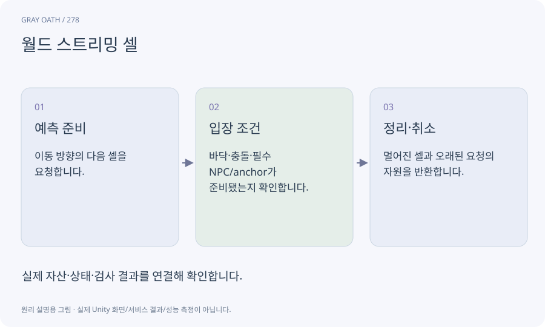

# 월드 스트리밍 셀

큰 월드를 작은 로드 단위로 나눠 플레이어 주변의 데이터를 준비하는 구조입니다. 셀 경계와 게임플레이 지역은 반드시 같지 않습니다.

## 익숙한 비유

지도책 전체를 책상에 펼치지 않고 현재 주변 페이지를 펼쳐 놓는 방식입니다.



## 작동 원리

### 1. 예측 준비

이동 방향의 다음 셀을 요청합니다.

### 2. 입장 조건

바닥·충돌·필수 NPC/anchor가 준비됐는지 확인합니다.

### 3. 정리·취소

멀어진 셀과 오래된 요청의 자원을 반환합니다.

## 게임 속 예

각 야외 지역을 네 셀로 나누고 마을과 실내를 추가 로드합니다. 되돌아갈 때 늦게 온 예전 로드 결과가 현재 위치를 덮으면 안 됩니다.

## 혼동하지 않기

비동기 로드라고 메인 스레드의 생성·업로드 비용이 자동으로 없어지지는 않습니다.

## 확인 질문

다운로드100%인데 입장 버튼이 왜 아직 비활성인가요?

디스크 로드·Instantiate·필수 충돌과 참조 준비가 남았을 수 있습니다.

## 내 프로젝트에서 확인하기

```text
현재 GrayOathRPG3D에서 월드 스트리밍 셀을 사용하는 실제 대상과 동작을 읽기 전용으로 확인해 줘. 쉬운 말과 작은 사례로 설명하고 비동기 로드라고 메인 스레드의 생성·업로드 비용이 자동으로 없어지지는 않습니다. 이 문제를 어떻게 막는지 보여 줘. 코드·데이터·설정은 아직 수정하지 마.
```

## 관련 해설

[additive-scene](additive-scene.md) · [async](async.md) · [cancellation](cancellation.md)

## 공식 참고

- [Unity · Addressables memory management](https://docs.unity3d.com/Packages/com.unity.addressables@2.7/manual/MemoryManagement.html)
