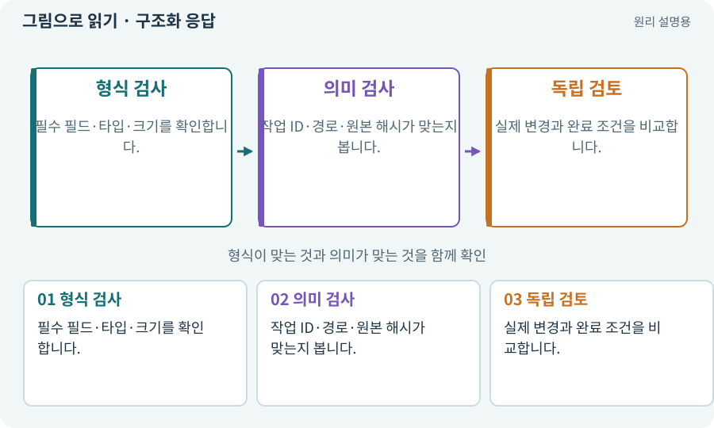

# 구조화 응답·변경안 계약

**분야:** AI·스킬·훅·하네스 운영

구조화 응답은 자유로운 설명 대신 정해진 필드와 타입으로 결과를 받는 방식입니다. 파일 경로·원본 해시·새 내용·작업 ID 등을 검증해 안전하게 후보로 다룰 수 있습니다.

**찾아오는 이름:** 구조화 응답·변경안 계약, 구조화 응답, structured_output, structured output, 응답 스키마, 변경안

## 익숙한 것에 비유하면

자유 편지 대신 필수 항목이 있는 작업 완료서를 받는 것입니다. 칸을 채웠다고 사실인지는 따로 확인합니다.



개념도입니다. 실제 Unity 화면이나 검사 결과가 아닙니다. 그림의 순서·색은 역할을 구분하며 실제 설정값은 프로젝트에서 확인합니다.

## 이렇게 작동합니다

### 1. 형식 검사

필수 필드·타입·크기를 확인합니다.

### 2. 의미 검사

작업 ID·경로·원본 해시가 맞는지 봅니다.

### 3. 독립 검토

실제 변경과 완료 조건을 비교합니다.

## 우리 RPG에서는 이렇게 만나요

AI가 “성공”이라는 설명만 썼는데 changes 필드가 없으면 코드 적용 후보가 아닙니다. 원본 해시가 다르면 다른 버전 파일을 대상으로 한 제안일 수 있습니다.

## 이것과 혼동하지 마세요

스키마를 통과한 결과도 악성 내용·잘못된 로직·범위 초과일 수 있습니다.

## 이해했는지 한 번 생각해 보기

구조화 응답이면 코드 검토가 필요 없나요?

<details><summary>답과 이유</summary>

아닙니다. 형식 검사는 시작이고 의미·권한·실제 동작 검사가 필요합니다.

</details>

## 내 프로젝트에서 확인하고 싶다면

아래 요청은 읽기 전용으로 실제 대상을 확인하는 선택 요청입니다. 코드나 설정을 직접 편집할 필요는 없습니다.

```text
현재 프로젝트에서 구조화 응답·변경안 계약 관련 요소가 어떻게 사용되는지 읽기 전용으로 확인해 줘. 실제 대상과 설정을 찾아 쉬운 말과 작은 예로 설명해 줘. 특히 다음 혼동을 구분해 줘: 스키마를 통과한 결과도 악성 내용·잘못된 로직·범위 초과일 수 있습니다. 아직 코드·설정·파일은 바꾸지 말고, 확인할 수 없는 내용은 따로 알려 줘.
```

## 이어지는 개념

[JSON·객체·배열·필드](json.md) · [스키마·JSON Schema·계약](schema.md) · [후보·스테이징·변경 적용](candidate.md) · [해시·SHA-256·체크섬](hash.md) · [QA·비평·독립 검토](review.md)

## 이 개념을 사용하는 실습

[107 · 원본을 보호하고 허용 경로 정하기](../index.html#lesson-107) · [108 · 기획·구현·QA·검토 역할 만들기](../index.html#lesson-108) · [111 · AI 답변을 안전한 변경안으로 받기](../index.html#lesson-111) · [112 · 네 역할을 순서대로 실행하기](../index.html#lesson-112) · [113 · 검토한 후보만 승인해 적용하기](../index.html#lesson-113) · [117 · Unity 작업을 한 창구로 모으기](../index.html#lesson-117) · [118 · 모의 응답 대신 실제 Claude 연결하기](../index.html#lesson-118) · [125 · 하네스로 작은 전리품 화면 만들기](../index.html#lesson-125) · [126 · 한 요청으로 필터 기능 끝내기](../index.html#lesson-126) · [129 · 기존 2D 게임에서 확장팩 시작하기](../index.html#lesson-129) · [130 · 첫 확장 작업을 하네스에 연결하기](../index.html#lesson-130) · [131 · 중요한 전리품만 표시하는 규칙 만들기](../index.html#lesson-131) · [132 · 필터를 실제 던전과 모바일에 연결하기](../index.html#lesson-132) · [133 · 첫 기능의 실패를 고쳐 다음 기준 만들기](../index.html#lesson-133) · [134 · 화상·냉기·표식으로 전투 확장하기](../index.html#lesson-134) · [135 · 벽을 통과하지 않는 회피 만들기](../index.html#lesson-135) · [136 · 방패병과 화염술사 정예 추가하기](../index.html#lesson-136) · [137 · 기름·폭발통·밸브로 공간 활용하기](../index.html#lesson-137) · [138 · 장비를 분해해 재료 얻기](../index.html#lesson-138) · [139 · 재료로 장비 제작하기](../index.html#lesson-139) · [140 · 개인 창고와 즐겨찾기 만들기](../index.html#lesson-140) · [141 · 소켓 한 칸에 룬 장착하기](../index.html#lesson-141) · [142 · 배운 스킬의 변형 선택하기](../index.html#lesson-142) · [143 · 새 랜덤 지역 봉인된 대장간 만들기](../index.html#lesson-143) · [144 · 이번 탐험에만 남는 유물 고르기](../index.html#lesson-144) · [145 · 지원 동료 하나 만들기](../index.html#lesson-145) · [146 · 대장장이 구조 퀘스트 만들기](../index.html#lesson-146) · [147 · 용광로 감시자와 3단계 전투 만들기](../index.html#lesson-147) · [148 · 아트 역할로 새 지역 외형 완성하기](../index.html#lesson-148) · [149 · 상태와 보스 효과를 같은 데이터로 맞추기](../index.html#lesson-149) · [150 · 소리가 없어도 읽히는 전투 만들기](../index.html#lesson-150) · [151 · 도감과 장비 비교로 새 기능 찾기](../index.html#lesson-151) · [152 · 이전 저장을 새 확장판으로 가져오기](../index.html#lesson-152) · [153 · 대장간 고해상도팩 선택 다운로드하기](../index.html#lesson-153) · [154 · 확장 기능을 켠 휴대폰 성능 고치기](../index.html#lesson-154) · [155 · 기록을 보고 제작 경제와 전투 조정하기](../index.html#lesson-155) · [156 · 기능 조합에서 숨은 오류 찾기](../index.html#lesson-156) · [157 · 하네스가 실패해도 기록 지키기](../index.html#lesson-157) · [158 · 룬 교체 버그를 역할로 수정하기](../index.html#lesson-158) · [159 · 최종 확장판 배포 후보 만들기](../index.html#lesson-159) · [160 · 대장간 보스까지 완주하고 새 기능 맡기기](../index.html#lesson-160)

## 참고와 설명의 범위

기본 도구 동작은 아래 공식 자료를 참고했습니다. 비유·그림·RPG의 예시 수치와 정책은 이해를 위한 자체 예제입니다. 실제 API·지원 기능은 설치 버전과 계정에서 확인합니다.

- [Claude Code · 비대화형 실행](https://code.claude.com/docs/en/headless)

그림·계산 예제·조작 모형은 자체 제작한 설명입니다. 실제 Unity 화면, 서비스 생성 결과, 성능 실측 또는 게임 테스트 결과가 아닙니다. 자료 확인: 2026년 9월 26일.
