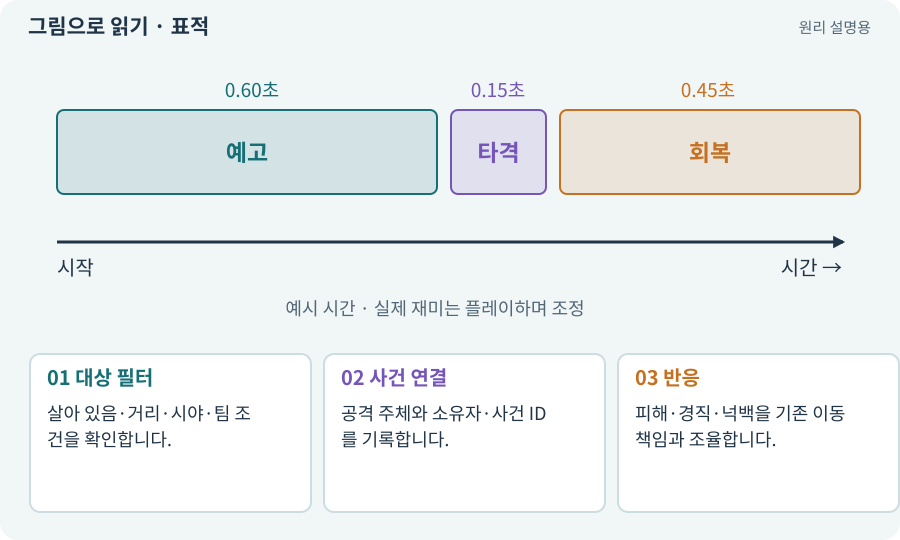

# 표적·팀·공격 주체·넉백

**분야:** 설명을 읽기 위한 기초 언어

표적 선택은 어떤 대상을 공격할지 정하는 규칙입니다. 공격 주체·소유자·팀을 구분하면 동료 피해와 보상, 우호 피해, 중복 효과를 관리할 수 있습니다. 넉백은 피격 시 밀리는 이동 효과입니다.

**찾아오는 이름:** 표적·팀·공격 주체·넉백, 표적, Target, targeting, team, ownerId, 넉백, Knockback, 경직, 우호 피해

## 익숙한 것에 비유하면

누가 던진 공이 누구에게 맞았는지와 실제로 밀려난 움직임을 구분하는 것입니다.



개념도입니다. 실제 Unity 화면이나 검사 결과가 아닙니다. 그림의 순서·색은 역할을 구분하며 실제 설정값은 프로젝트에서 확인합니다.

## 이렇게 작동합니다

### 1. 대상 필터

살아 있음·거리·시야·팀 조건을 확인합니다.

### 2. 사건 연결

공격 주체와 소유자·사건 ID를 기록합니다.

### 3. 반응

피해·경직·넉백을 기존 이동 책임과 조율합니다.

## 우리 RPG에서는 이렇게 만나요

지원 드론이 공격할 때 플레이어의 모든 적중 룬을 또 발동시키면 의도하지 않은 연쇄가 생길 수 있습니다. 공격 출처와 효과 발동 조건을 나눕니다.

## 이것과 혼동하지 마세요

넉백이 별도 스크립트로 위치를 무조건 덮으면 벽 통과나 이동 모터 충돌이 생길 수 있습니다.

## 이해했는지 한 번 생각해 보기

죽은 적을 계속 추적하면 무엇을 보나요?

<details><summary>답과 이유</summary>

표적 유효성·사망 이벤트·현재 요청의 취소와 다음 선택을 확인합니다.

</details>

## 내 프로젝트에서 확인하고 싶다면

아래 요청은 읽기 전용으로 실제 대상을 확인하는 선택 요청입니다. 코드나 설정을 직접 편집할 필요는 없습니다.

```text
현재 프로젝트에서 표적·팀·공격 주체·넉백 관련 요소가 어떻게 사용되는지 읽기 전용으로 확인해 줘. 실제 대상과 설정을 찾아 쉬운 말과 작은 예로 설명해 줘. 특히 다음 혼동을 구분해 줘: 넉백이 별도 스크립트로 위치를 무조건 덮으면 벽 통과나 이동 모터 충돌이 생길 수 있습니다. 아직 코드·설정·파일은 바꾸지 말고, 확인할 수 없는 내용은 따로 알려 줘.
```

## 이어지는 개념

[공격 ID·사건 ID·중복 피해 방지](event-id.md) · [피해 계산·스냅샷·피해 사건](damage.md) · [이동 모터와 단일 위치 책임](motor.md) · [시야·LOS·마지막 목격 위치](los.md)

## 이 개념을 사용하는 실습

[08 · WASD로 벽에 부딪히며 이동하기](../index.html#lesson-008) · [13 · 적을 클릭해 접근하고 공격하기](../index.html#lesson-013) · [14 · 나를 발견하고 공격하는 적 만들기](../index.html#lesson-014) · [48 · 적이 나를 보고 놓치게 만들기](../index.html#lesson-048) · [49 · 여러 근접 적의 공격 나누기](../index.html#lesson-049) · [50 · 석궁수가 거리를 유지하게 만들기](../index.html#lesson-050) · [51 · 전투 전체의 압박 조절하기](../index.html#lesson-051) · [72 · 모바일 효과를 줄여도 위험은 남기기](../index.html#lesson-072) · [83 · 3D 카메라와 재질로 공간 보기](../index.html#lesson-083) · [85 · 3D 캐릭터를 한 모터로 움직이기](../index.html#lesson-085) · [86 · 3D에서도 클릭한 곳까지 돌아가기](../index.html#lesson-086) · [89 · 같은 전투 규칙을 3D에 연결하기](../index.html#lesson-089) · [145 · 지원 동료 하나 만들기](../index.html#lesson-145) · [154 · 확장 기능을 켠 휴대폰 성능 고치기](../index.html#lesson-154)

## 참고와 설명의 범위

이 항목의 비유·그림·RPG 수치·운영 규칙은 개념을 이해하기 위한 자체 설계 예제입니다. 특정 도구가 이 규칙을 자동으로 구현한다는 뜻은 아닙니다.


그림·계산 예제·조작 모형은 자체 제작한 설명입니다. 실제 Unity 화면, 서비스 생성 결과, 성능 실측 또는 게임 테스트 결과가 아닙니다. 자료 확인: 2026년 9월 26일.
