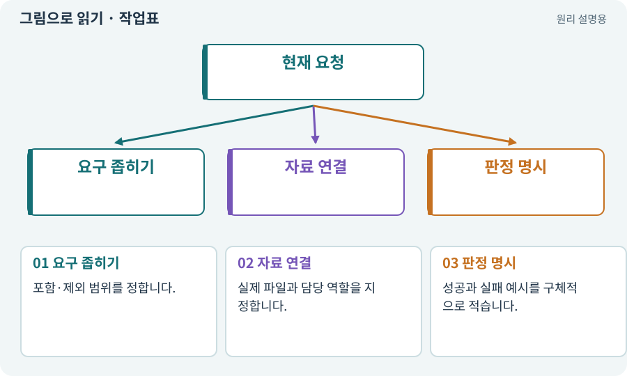

# 작업표·완료 조건·계획

**분야:** AI·스킬·훅·하네스 운영

작업표는 목표·담당·입력·출력·선행 작업·완료 조건을 명시한 실행 계약입니다. 기획 AI가 초안을 만들 수 있지만 허용 경로·예산·실행 승인까지 마음대로 정하게 하지 않습니다.

**찾아오는 이름:** 작업표·완료 조건·계획, 작업표, Task JSON, acceptance, 완료 조건, 작업 계획, planner, Planner, 완료 계약

## 익숙한 것에 비유하면

공사 주문서에 “좋게 만들어라” 대신 무엇을 어디에 만들고 어떻게 검사할지 적는 것입니다.



개념도입니다. 실제 Unity 화면이나 검사 결과가 아닙니다. 그림의 순서·색은 역할을 구분하며 실제 설정값은 프로젝트에서 확인합니다.

## 이렇게 작동합니다

### 1. 요구 좁히기

포함·제외 범위를 정합니다.

### 2. 자료 연결

실제 파일과 담당 역할을 지정합니다.

### 3. 판정 명시

성공과 실패 예시를 구체적으로 적습니다.

## 우리 RPG에서는 이렇게 만나요

전리품 필터는 이름표만 숨기고 바닥 아이템·줍기는 유지한다는 조건을 적습니다. “동작한다”나 공백뿐인 완료 조건은 검토하기 어렵습니다.

## 이것과 혼동하지 마세요

계획이 JSON이라는 이유로 타당하거나 승인된 것은 아닙니다.

## 이해했는지 한 번 생각해 보기

없는 파일명이 계획에 있으면 바로 만들면 되나요?

<details><summary>답과 이유</summary>

현재 실제 파일을 먼저 조사하고 신규 생성이 필요한지 판단해야 합니다.

</details>

## 내 프로젝트에서 확인하고 싶다면

아래 요청은 읽기 전용으로 실제 대상을 확인하는 선택 요청입니다. 코드나 설정을 직접 편집할 필요는 없습니다.

```text
현재 프로젝트에서 작업표·완료 조건·계획 관련 요소가 어떻게 사용되는지 읽기 전용으로 확인해 줘. 실제 대상과 설정을 찾아 쉬운 말과 작은 예로 설명해 줘. 특히 다음 혼동을 구분해 줘: 계획이 JSON이라는 이유로 타당하거나 승인된 것은 아닙니다. 아직 코드·설정·파일은 바꾸지 말고, 확인할 수 없는 내용은 따로 알려 줘.
```

## 이어지는 개념

[의존성·DAG·위상 정렬](dependency.md) · [파일 소유권·읽기 범위·쓰기 범위](ownership.md) · [실제 파일 바인딩·앵커·심볼](binding.md) · [스키마·JSON Schema·계약](schema.md)

## 이 개념을 사용하는 실습

[31 · 퀘스트를 받아 엔딩까지 이어가기](../index.html#lesson-031) · [46 · 랜덤 지도 위를 실제로 걷기](../index.html#lesson-046) · [109 · 요청을 검사 가능한 작업표로 바꾸기](../index.html#lesson-109) · [110 · 작업마다 필요한 자료만 준비하기](../index.html#lesson-110) · [113 · 검토한 후보만 승인해 적용하기](../index.html#lesson-113) · [120 · 자연어 요청을 계획으로 바꾸기](../index.html#lesson-120) · [123 · 기존 게임의 실제 파일 찾아 연결하기](../index.html#lesson-123) · [127 · 내 반복 업무에 맞게 도구 개조하기](../index.html#lesson-127) · [133 · 첫 기능의 실패를 고쳐 다음 기준 만들기](../index.html#lesson-133)

## 참고와 설명의 범위

이 항목의 비유·그림·RPG 수치·운영 규칙은 개념을 이해하기 위한 자체 설계 예제입니다. 특정 도구가 이 규칙을 자동으로 구현한다는 뜻은 아닙니다.


그림·계산 예제·조작 모형은 자체 제작한 설명입니다. 실제 Unity 화면, 서비스 생성 결과, 성능 실측 또는 게임 테스트 결과가 아닙니다. 자료 확인: 2026년 9월 26일.
