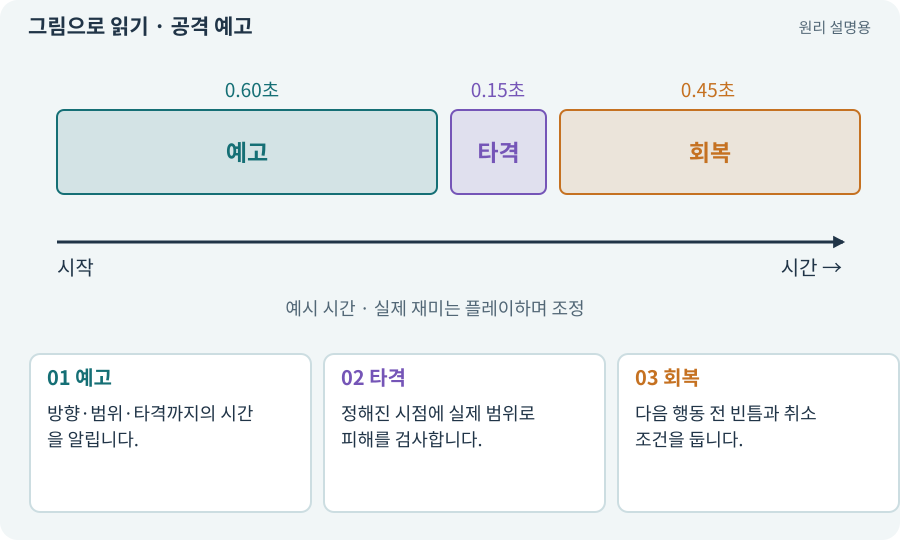

# 공격 예고·선행동작·회복

**분야:** 지도·적 AI·전투 규칙

공격 예고는 피해가 발생하기 전에 어디에 어떤 공격이 올지 알려 주는 시각·소리·동작입니다. 공격 뒤 회복은 플레이어가 반격할 기회를 만드는 시간입니다.

**찾아오는 이름:** 공격 예고·선행동작·회복, 공격 예고, Telegraph, 텔레그래프, 선행동작, 후딜레이, 공격 약속

## 익숙한 것에 비유하면

길을 건너기 전 신호등이 바뀌는 것과 비슷합니다. 표시와 실제 위험의 위치·시점이 맞아야 믿고 판단할 수 있습니다.



개념도입니다. 실제 Unity 화면이나 검사 결과가 아닙니다. 그림의 순서·색은 역할을 구분하며 실제 설정값은 프로젝트에서 확인합니다.

## 이렇게 작동합니다

### 1. 예고

방향·범위·타격까지의 시간을 알립니다.

### 2. 타격

정해진 시점에 실제 범위로 피해를 검사합니다.

### 3. 회복

다음 행동 전 빈틈과 취소 조건을 둡니다.

## 예고 → 타격 → 회복을 같은 공격의 시간표로 묶으세요

예고는 플레이어에게 피하거나 대응할 기회를 주는 구간입니다. 타격 시점에는 실제 사거리·각도·중심과 맞는 판정이 필요합니다. 회복은 다음 행동까지의 빈틈입니다.

효과를 만드는 코드와 피해를 주는 코드가 각자 다른 반경을 사용하면 경고 밖에서 맞거나 경고 안인데 안 맞는 문제가 생깁니다. 공격 시작 때 같은 규격의 스냅샷을 공유할 수 있습니다.

아래 모형의 0.6초 예고·0.15초 타격·0.45초 회복은 원리 설명용 초기값입니다. 재미를 보장하는 정답이 아니며 모바일 조작과 적 조합에서 직접 조정합니다.

| 구간 | 플레이어가 읽는 것 | 취소 시 확인 |
| --- | --- | --- |
| 예고 | 위험 위치·방향 | 표시·예약 타격 제거 |
| 타격 | 실제 접촉과 피해 | 같은 공격 중복 방지 |
| 회복 | 적의 빈틈 | 다음 공격 중복 시작 금지 |

## 직접 값을 바꾸며 보기

[웹 해설의 조작 모형 열기](../index.html#tech-telegraph). 조작은 설명용 모형만 바꿉니다. 실제 프로젝트·AI·진행 체크·게임 테스트는 실행하거나 변경하지 않습니다.

## 우리 RPG에서는 이렇게 만나요

보스의 붉은 원이 2m 반경을 보여 주는데 실제 3m를 때리면 피한 느낌이 들지 않습니다. 가능하면 같은 공격 데이터로 예고와 판정을 만듭니다.

## 이것과 혼동하지 마세요

화려한 바닥 효과가 모두 피해 영역인 것은 아닙니다. 위험 표시는 장식과 명확히 구분합니다.

## 이해했는지 한 번 생각해 보기

낮은 그래픽 품질에서 예고를 없애도 괜찮나요?

<details><summary>답과 이유</summary>

핵심 판단 정보이므로 남겨야 합니다. 줄일 것은 장식 효과입니다.

</details>

## 내 프로젝트에서 확인하고 싶다면

아래 요청은 읽기 전용으로 실제 대상을 확인하는 선택 요청입니다. 코드나 설정을 직접 편집할 필요는 없습니다.

```text
현재 프로젝트에서 공격 예고·선행동작·회복 관련 요소가 어떻게 사용되는지 읽기 전용으로 확인해 줘. 실제 대상과 설정을 찾아 쉬운 말과 작은 예로 설명해 줘. 특히 다음 혼동을 구분해 줘: 화려한 바닥 효과가 모두 피해 영역인 것은 아닙니다. 위험 표시는 장식과 명확히 구분합니다. 아직 코드·설정·파일은 바꾸지 말고, 확인할 수 없는 내용은 따로 알려 줘.
```

## 이어지는 개념

[Hitbox·Hurtbox·Body](hitbox.md) · [쿨다운·마나·자원 소비](cooldown.md) · [VFX·Particle System·플립북](vfx.md) · [접근성·가독성·피드백](accessibility.md)

## 이 개념을 사용하는 실습

[07 · 캐릭터와 벽이 있는 공간 만들기](../index.html#lesson-007) · [14 · 나를 발견하고 공격하는 적 만들기](../index.html#lesson-014) · [15 · 다른 방식으로 싸우는 적 추가하기](../index.html#lesson-015) · [19 · 누가 때렸는지 보이는 전투 만들기](../index.html#lesson-019) · [32 · 길 안내와 처음 하는 사람의 동선 만들기](../index.html#lesson-032) · [35 · 앞뒤 가림과 PC 조작 다듬기](../index.html#lesson-035) · [37 · 느려지는 원인을 측정해 고치기](../index.html#lesson-037) · [48 · 적이 나를 보고 놓치게 만들기](../index.html#lesson-048) · [49 · 여러 근접 적의 공격 나누기](../index.html#lesson-049) · [50 · 석궁수가 거리를 유지하게 만들기](../index.html#lesson-050) · [51 · 전투 전체의 압박 조절하기](../index.html#lesson-051) · [53 · 입력은 빠르게, 취소 규칙은 명확하게](../index.html#lesson-053) · [66 · 타일 경계와 랜덤맵 외형 연결하기](../index.html#lesson-066) · [68 · 피격 불꽃과 먼지 만들기](../index.html#lesson-068) · [69 · 베기와 폭발을 시트 애니메이션으로 만들기](../index.html#lesson-069) · [70 · 피격 강조와 보스 예고 셰이더 만들기](../index.html#lesson-070) · [72 · 모바일 효과를 줄여도 위험은 남기기](../index.html#lesson-072) · [90 · 적의 판단을 3D 공간에 연결하기](../index.html#lesson-090) · [91 · 보스 예고를 3D 바닥에 맞추기](../index.html#lesson-091) · [149 · 상태와 보스 효과를 같은 데이터로 맞추기](../index.html#lesson-149) · [154 · 확장 기능을 켠 휴대폰 성능 고치기](../index.html#lesson-154)

## 참고와 설명의 범위

이 항목의 비유·그림·RPG 수치·운영 규칙은 개념을 이해하기 위한 자체 설계 예제입니다. 특정 도구가 이 규칙을 자동으로 구현한다는 뜻은 아닙니다.


그림·계산 예제·조작 모형은 자체 제작한 설명입니다. 실제 Unity 화면, 서비스 생성 결과, 성능 실측 또는 게임 테스트 결과가 아닙니다. 자료 확인: 2026년 9월 26일.
