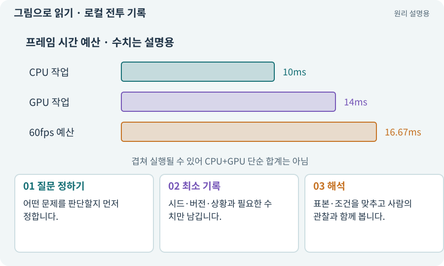

# 로컬 전투 기록·텔레메트리

**분야:** 비동기·다운로드·빌드·버전 관리

텔레메트리는 실제 사용 중 발생한 사건과 측정을 기록하는 것입니다. 이 과정에서는 개인을 추적하는 서버 분석보다 로컬 전투 시간·피해 원인·재료 수지·입력 실패 같은 자료를 사용합니다.

**찾아오는 이름:** 로컬 전투 기록·텔레메트리, 텔레메트리, Telemetry, telemetry, 전투 기록, 측정 기록, 플레이 로그

## 익숙한 것에 비유하면

운동 기록계가 시간과 거리를 남기듯 게임의 사건을 비교할 근거를 만드는 것입니다.



개념도입니다. 실제 Unity 화면이나 검사 결과가 아닙니다. 그림의 순서·색은 역할을 구분하며 실제 설정값은 프로젝트에서 확인합니다.

## 이렇게 작동합니다

### 1. 질문 정하기

어떤 문제를 판단할지 먼저 정합니다.

### 2. 최소 기록

시드·버전·상황과 필요한 수치만 남깁니다.

### 3. 해석

표본·조건을 맞추고 사람의 관찰과 함께 봅니다.

## 우리 RPG에서는 이렇게 만나요

같은 장비·시드에서 새 회피 규칙 전후의 피해 횟수와 입력 실패를 비교합니다. 생존율이 올랐다고 재미도 자동 상승했다고 결론내리지 않습니다.

## 이것과 혼동하지 마세요

사용자 개인정보나 토큰·키·실제 저장 전체를 무분별하게 업로드하지 않습니다.

## 이해했는지 한 번 생각해 보기

보스 처치 시간이 짧아졌다면 항상 개선인가요?

<details><summary>답과 이유</summary>

의미 있는 선택과 위험·몰입이 유지되는지 실제 플레이도 확인해야 합니다.

</details>

## 내 프로젝트에서 확인하고 싶다면

아래 요청은 읽기 전용으로 실제 대상을 확인하는 선택 요청입니다. 코드나 설정을 직접 편집할 필요는 없습니다.

```text
현재 프로젝트에서 로컬 전투 기록·텔레메트리 관련 요소가 어떻게 사용되는지 읽기 전용으로 확인해 줘. 실제 대상과 설정을 찾아 쉬운 말과 작은 예로 설명해 줘. 특히 다음 혼동을 구분해 줘: 사용자 개인정보나 토큰·키·실제 저장 전체를 무분별하게 업로드하지 않습니다. 아직 코드·설정·파일은 바꾸지 말고, 확인할 수 없는 내용은 따로 알려 줘.
```

## 이어지는 개념

[밸런스·위험과 보상·플레이테스트](balance.md) · [Profiler·병목·실기기 측정](profiler.md) · [공격 ID·사건 ID·중복 피해 방지](event-id.md) · [증거·검사 상태·미실행](evidence.md)

## 이 개념을 사용하는 실습

다른 개념을 이해하기 위한 보충 해설입니다.

## 참고와 설명의 범위

이 항목의 비유·그림·RPG 수치·운영 규칙은 개념을 이해하기 위한 자체 설계 예제입니다. 특정 도구가 이 규칙을 자동으로 구현한다는 뜻은 아닙니다.


그림·계산 예제·조작 모형은 자체 제작한 설명입니다. 실제 Unity 화면, 서비스 생성 결과, 성능 실측 또는 게임 테스트 결과가 아닙니다. 자료 확인: 2026년 9월 26일.
