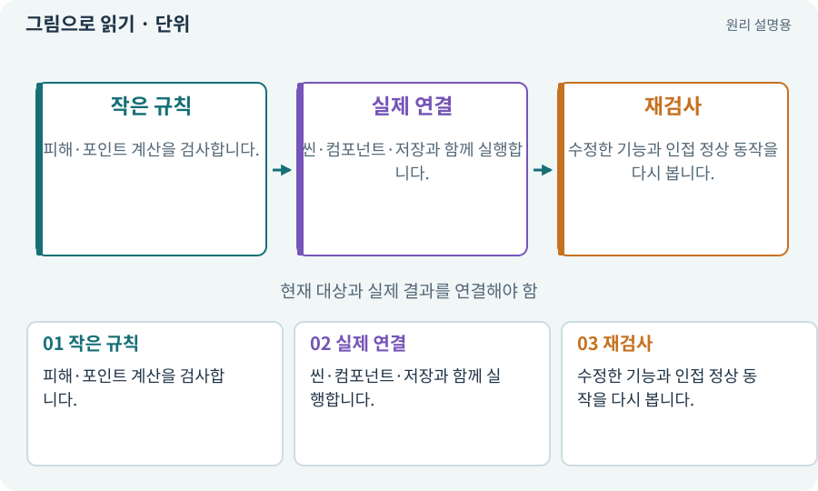

# 단위·통합·회귀 테스트

**분야:** 코드·데이터·저장·검사

단위 테스트는 작은 규칙, 통합 테스트는 연결된 여러 요소, 회귀 테스트는 예전에 고친 문제나 정상 기능이 다시 깨지지 않았는지 확인합니다. 서로 대체되지 않습니다.

**찾아오는 이름:** 단위·통합·회귀 테스트, 단위 테스트, 통합 테스트, 회귀 테스트, Unit Test, NUnit, unittest, 자동 테스트

## 익숙한 것에 비유하면

부품 검사·조립 검사·수리 후 재검사를 나누는 것입니다.



개념도입니다. 실제 Unity 화면이나 검사 결과가 아닙니다. 그림의 순서·색은 역할을 구분하며 실제 설정값은 프로젝트에서 확인합니다.

## 이렇게 작동합니다

### 1. 작은 규칙

피해·포인트 계산을 검사합니다.

### 2. 실제 연결

씬·컴포넌트·저장과 함께 실행합니다.

### 3. 재검사

수정한 기능과 인접 정상 동작을 다시 봅니다.

## 우리 RPG에서는 이렇게 만나요

LootFilter 함수 검사 통과는 실제 드롭 이름표·터치 버튼·줍기 연결의 성공이 아닙니다. 목적에 맞는 테스트와 직접 플레이가 모두 필요합니다.

## 이것과 혼동하지 마세요

테스트 파일 수와 실제 실행된 검사 수는 다릅니다. 0개 실행을 성공으로 기록하지 않습니다.

## 이해했는지 한 번 생각해 보기

단위 테스트가 전부 통과했는데 버튼이 안 되면?

<details><summary>답과 이유</summary>

UI·입력·참조 통합 검사가 빠졌을 수 있습니다.

</details>

## 내 프로젝트에서 확인하고 싶다면

아래 요청은 읽기 전용으로 실제 대상을 확인하는 선택 요청입니다. 코드나 설정을 직접 편집할 필요는 없습니다.

```text
현재 프로젝트에서 단위·통합·회귀 테스트 관련 요소가 어떻게 사용되는지 읽기 전용으로 확인해 줘. 실제 대상과 설정을 찾아 쉬운 말과 작은 예로 설명해 줘. 특히 다음 혼동을 구분해 줘: 테스트 파일 수와 실제 실행된 검사 수는 다릅니다. 0개 실행을 성공으로 기록하지 않습니다. 아직 코드·설정·파일은 바꾸지 말고, 확인할 수 없는 내용은 따로 알려 줘.
```

## 이어지는 개념

[픽스처·Mock·Stub·테스트 더블](fixture.md) · [회귀·기준선·수정 전후 비교](regression.md) · [증거·검사 상태·미실행](evidence.md) · [파서·XML·결과 판정](parser.md)

## 이 개념을 사용하는 실습

[06 · 시작 메뉴와 테스트 공간 연결하기](../index.html#lesson-006) · [17 · 적을 잡아 레벨 올리기](../index.html#lesson-017) · [38 · 테스트 결과와 실제 플레이 구분하기](../index.html#lesson-038) · [40 · 작은 RPG를 처음부터 끝까지 플레이하기](../index.html#lesson-040) · [54 · 느낌을 근거로 밸런스 고치기](../index.html#lesson-054) · [103 · 같은 전투를 2D와 3D로 플레이하기](../index.html#lesson-103) · [126 · 한 요청으로 필터 기능 끝내기](../index.html#lesson-126) · [157 · 하네스가 실패해도 기록 지키기](../index.html#lesson-157)

## 참고와 설명의 범위

기본 도구 동작은 아래 공식 자료를 참고했습니다. 비유·그림·RPG의 예시 수치와 정책은 이해를 위한 자체 예제입니다. 실제 API·지원 기능은 설치 버전과 계정에서 확인합니다.

- [Unity · 테스트 실행과 결과](https://docs.unity3d.com/Packages/com.unity.test-framework@1.4/manual/reference-command-line.html)
- [Python · unittest](https://docs.python.org/3/library/unittest.html)

그림·계산 예제·조작 모형은 자체 제작한 설명입니다. 실제 Unity 화면, 서비스 생성 결과, 성능 실측 또는 게임 테스트 결과가 아닙니다. 자료 확인: 2026년 9월 26일.
