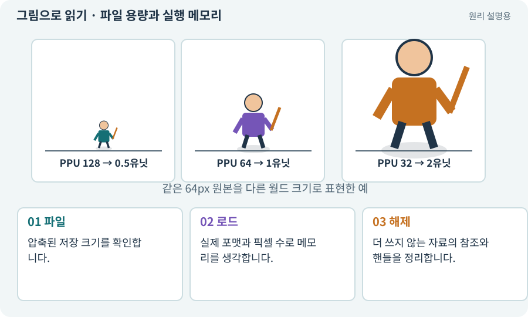

# 파일 용량과 실행 메모리

**분야:** 입력·UI·소리·성능

파일 용량은 저장장치의 바이트 수이고 실행 메모리는 로드 후 필요한 공간입니다. 같은 PNG라도 실행 형식·해상도·밉맵·플랫폼 압축에 따라 메모리가 달라집니다.

**찾아오는 이름:** 파일 용량과 실행 메모리, 파일 용량, GPU 메모리, 텍스처 메모리, 해상도 예산

## 익숙한 것에 비유하면

진공 포장된 이불의 크기와 펼친 이불이 차지하는 공간의 차이입니다.



개념도입니다. 실제 Unity 화면이나 검사 결과가 아닙니다. 그림의 순서·색은 역할을 구분하며 실제 설정값은 프로젝트에서 확인합니다.

## 이렇게 작동합니다

### 1. 파일

압축된 저장 크기를 확인합니다.

### 2. 로드

실제 포맷과 픽셀 수로 메모리를 생각합니다.

### 3. 해제

더 쓰지 않는 자료의 참조와 핸들을 정리합니다.

## 우리 RPG에서는 이렇게 만나요

설명용 비압축 RGBA8 1024×1024는 기본 픽셀만 약 4MiB입니다. 2048×2048은 약 16MiB로 가로·세로 2배가 메모리 4배가 됩니다. 실제 포맷 비용은 따로 확인합니다.

## 이것과 혼동하지 마세요

해상도 2배는 픽셀 수 2배가 아니라 면적 기준 4배입니다.

## 이해했는지 한 번 생각해 보기

512×512 RGBA8 기본 픽셀은 대략 얼마인가요?

<details><summary>답과 이유</summary>

약 1MiB입니다. 밉맵·정렬·복사본 등은 포함하지 않은 설명용 계산입니다.

</details>

## 내 프로젝트에서 확인하고 싶다면

아래 요청은 읽기 전용으로 실제 대상을 확인하는 선택 요청입니다. 코드나 설정을 직접 편집할 필요는 없습니다.

```text
현재 프로젝트에서 파일 용량과 실행 메모리 관련 요소가 어떻게 사용되는지 읽기 전용으로 확인해 줘. 실제 대상과 설정을 찾아 쉬운 말과 작은 예로 설명해 줘. 특히 다음 혼동을 구분해 줘: 해상도 2배는 픽셀 수 2배가 아니라 면적 기준 4배입니다. 아직 코드·설정·파일은 바꾸지 말고, 확인할 수 없는 내용은 따로 알려 줘.
```

## 이어지는 개념

[텍스처·픽셀·해상도](texture.md) · [밉맵·텍스처 압축](mipmap.md) · [핸들·참조 계수·Release](handle.md) · [Addressables·주소로 에셋 불러오기](addressables.md)

## 이 개념을 사용하는 실습

다른 개념을 이해하기 위한 보충 해설입니다.

## 참고와 설명의 범위

기본 도구 동작은 아래 공식 자료를 참고했습니다. 비유·그림·RPG의 예시 수치와 정책은 이해를 위한 자체 예제입니다. 실제 API·지원 기능은 설치 버전과 계정에서 확인합니다.

- [Unity · Sprite](https://docs.unity3d.com/6000.3/Documentation/Manual/sprite/sprite-landing.html)
- [Unity Addressables · 메모리 관리](https://docs.unity3d.com/Packages/com.unity.addressables@2.7/manual/MemoryManagement.html)

그림·계산 예제·조작 모형은 자체 제작한 설명입니다. 실제 Unity 화면, 서비스 생성 결과, 성능 실측 또는 게임 테스트 결과가 아닙니다. 자료 확인: 2026년 9월 26일.
