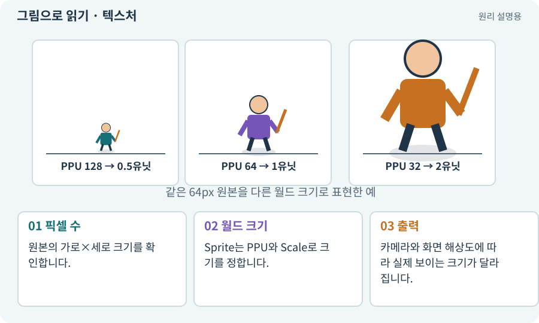

# 텍스처·픽셀·해상도

**분야:** 그림·애니메이션·화면 만들기

텍스처는 화면을 그릴 때 사용하는 이미지 자료이고 픽셀은 그 이미지를 구성하는 작은 색 단위입니다. 해상도는 가로·세로 픽셀 수입니다. 파일 용량과 화면상의 크기는 별개의 값입니다.

**찾아오는 이름:** 텍스처·픽셀·해상도, 텍스처, Texture, 픽셀, pixel, resolution

## 익숙한 것에 비유하면

모자이크 타일의 색과 타일 개수입니다. 타일이 많아도 벽에 얼마 크기로 붙이는지는 따로 정합니다.



개념도입니다. 실제 Unity 화면이나 검사 결과가 아닙니다. 그림의 순서·색은 역할을 구분하며 실제 설정값은 프로젝트에서 확인합니다.

## 이렇게 작동합니다

### 1. 픽셀 수

원본의 가로×세로 크기를 확인합니다.

### 2. 월드 크기

Sprite는 PPU와 Scale로 크기를 정합니다.

### 3. 출력

카메라와 화면 해상도에 따라 실제 보이는 크기가 달라집니다.

## 우리 RPG에서는 이렇게 만나요

64×64 그림을 PPU 64로 쓰면 Scale 1 기준 1×1 월드 단위입니다. 128×128로 바꿔도 PPU를 128로 맞추면 같은 크기로 표시할 수 있습니다.

## 이것과 혼동하지 마세요

PNG가 작은 파일이어도 GPU 메모리까지 같은 크기는 아닙니다. 압축·포맷·밉맵에 따라 달라집니다.

## 이해했는지 한 번 생각해 보기

해상도를 2배 올리면 화면 캐릭터도 반드시 2배인가요?

<details><summary>답과 이유</summary>

아닙니다. PPU·Scale·카메라에 따라 결정됩니다.

</details>

## 내 프로젝트에서 확인하고 싶다면

아래 요청은 읽기 전용으로 실제 대상을 확인하는 선택 요청입니다. 코드나 설정을 직접 편집할 필요는 없습니다.

```text
현재 프로젝트에서 텍스처·픽셀·해상도 관련 요소가 어떻게 사용되는지 읽기 전용으로 확인해 줘. 실제 대상과 설정을 찾아 쉬운 말과 작은 예로 설명해 줘. 특히 다음 혼동을 구분해 줘: PNG가 작은 파일이어도 GPU 메모리까지 같은 크기는 아닙니다. 압축·포맷·밉맵에 따라 달라집니다. 아직 코드·설정·파일은 바꾸지 말고, 확인할 수 없는 내용은 따로 알려 줘.
```

## 이어지는 개념

[PPU: 픽셀과 월드 크기](ppu.md) · [알파·RGBA·투명 배경](alpha.md) · [파일 용량과 실행 메모리](texture-compression.md) · [카메라·직교·원근](camera.md)

## 이 개념을 사용하는 실습

[05 · 말로 스프라이트 하나 만들기](../index.html#lesson-005) · [07 · 캐릭터와 벽이 있는 공간 만들기](../index.html#lesson-007) · [33 · 기본 캐릭터·몬스터·타일 아트 만들기](../index.html#lesson-033) · [37 · 느려지는 원인을 측정해 고치기](../index.html#lesson-037) · [44 · 시드로 같은 던전 다시 만들기](../index.html#lesson-044) · [58 · PixelLab로 방향별 픽셀 캐릭터 만들기](../index.html#lesson-058) · [59 · Retro Diffusion으로 캐릭터와 타일 만들기](../index.html#lesson-059) · [60 · Scenario로 스타일과 동작 유지하기](../index.html#lesson-060) · [65 · 스프라이트를 정리해 실제 캐릭터에 넣기](../index.html#lesson-065) · [67 · 내 게임의 아트 제작 경로 선택하기](../index.html#lesson-067) · [68 · 피격 불꽃과 먼지 만들기](../index.html#lesson-068) · [69 · 베기와 폭발을 시트 애니메이션으로 만들기](../index.html#lesson-069) · [72 · 모바일 효과를 줄여도 위험은 남기기](../index.html#lesson-072) · [77 · 앱을 바꾸지 않고 외형 업데이트하기](../index.html#lesson-077) · [84 · 같은 지도를 3D 바닥과 벽으로 만들기](../index.html#lesson-084) · [95 · 3D 조명과 환경을 읽기 좋게 만들기](../index.html#lesson-095) · [100 · 두 버전이 같은 게임인지 비교하기](../index.html#lesson-100)

## 참고와 설명의 범위

기본 도구 동작은 아래 공식 자료를 참고했습니다. 비유·그림·RPG의 예시 수치와 정책은 이해를 위한 자체 예제입니다. 실제 API·지원 기능은 설치 버전과 계정에서 확인합니다.

- [Unity · Sprite](https://docs.unity3d.com/6000.3/Documentation/Manual/sprite/sprite-landing.html)

그림·계산 예제·조작 모형은 자체 제작한 설명입니다. 실제 Unity 화면, 서비스 생성 결과, 성능 실측 또는 게임 테스트 결과가 아닙니다. 자료 확인: 2026년 9월 26일.
