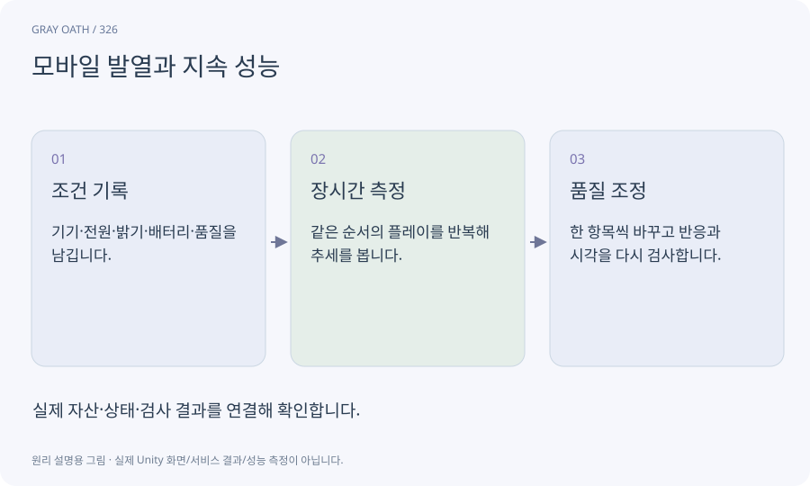

# 모바일 발열과 지속 성능

기기가 오래 작동하면서 온도와 전력 제한 때문에 유지할 수 있는 성능의 범위입니다. 짧은 시작 측정과 오래 플레이한 뒤의 결과가 다를 수 있습니다.

## 익숙한 비유

전력 질주 속도와 긴 거리에서 유지할 수 있는 속도의 차이입니다.



## 작동 원리

### 1. 조건 기록

기기·전원·밝기·배터리·품질을 남깁니다.

### 2. 장시간 측정

같은 순서의 플레이를 반복해 추세를 봅니다.

### 3. 품질 조정

한 항목씩 바꾸고 반응과 시각을 다시 검사합니다.

## 게임 속 예

20분 검사 중1분 단위 프레임 분포를 남깁니다. 접근할 수 없는 내부 온도는 사람이 느낀 열감과 별도로 미확인 처리합니다.

## 혼동하지 않기

한 기기의 짧은 성공을 모든 Android 기기의 품질 보장으로 바꾸지 않습니다.

## 확인 질문

자동 품질이 계속 오르내리면?

상향·하향 임계값과 유지시간을 다르게 두는 hysteresis를 넣어 출렁임을 줄입니다.

## 내 프로젝트에서 확인하기

```text
현재 GrayOathRPG3D에서 모바일 발열과 지속 성능을 사용하는 실제 대상과 동작을 읽기 전용으로 확인해 줘. 쉬운 말과 작은 사례로 설명하고 한 기기의 짧은 성공을 모든 Android 기기의 품질 보장으로 바꾸지 않습니다. 이 문제를 어떻게 막는지 보여 줘. 코드·데이터·설정은 아직 수정하지 마.
```

## 관련 해설

[percentile](percentile.md) · [frame-time](frame-time.md) · [platform](platform.md)

## 공식 참고

- [Unity · 실제 대상 기기 프로파일링](https://docs.unity3d.com/6000.3/Documentation/Manual/profiling-target-device.html)
