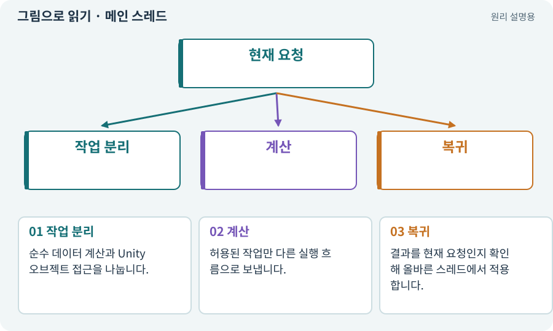

# 메인 스레드·작업 스레드

**분야:** 설명을 읽기 위한 기초 언어

스레드는 프로세스 안에서 명령을 실행하는 흐름입니다. Unity의 많은 오브젝트·렌더 API는 메인 스레드에서 다뤄야 합니다. 비동기 API와 병렬 계산의 스레드 조건을 구분합니다.

**찾아오는 이름:** 메인 스레드·작업 스레드, 스레드, Thread, thread, 메인 스레드, 작업 스레드, Task.Run

## 익숙한 것에 비유하면

작업자 여러 명이 있어도 특정 기계는 담당자만 만져야 하는 공장과 같습니다.



개념도입니다. 실제 Unity 화면이나 검사 결과가 아닙니다. 그림의 순서·색은 역할을 구분하며 실제 설정값은 프로젝트에서 확인합니다.

## 이렇게 작동합니다

### 1. 작업 분리

순수 데이터 계산과 Unity 오브젝트 접근을 나눕니다.

### 2. 계산

허용된 작업만 다른 실행 흐름으로 보냅니다.

### 3. 복귀

결과를 현재 요청인지 확인해 올바른 스레드에서 적용합니다.

## 우리 RPG에서는 이렇게 만나요

랜덤맵 셀 계산은 순수 데이터로 분리할 수 있지만 Tilemap·GameObject를 만드는 작업은 API 조건에 맞게 수행합니다. 동시에 같은 목록을 바꾸면 경쟁 상태가 생길 수 있습니다.

## 이것과 혼동하지 마세요

CPU 코어가 많다고 모든 게임 동작을 자동으로 병렬 처리하지 않습니다.

## 이해했는지 한 번 생각해 보기

Task.Run 안에서 씬 오브젝트를 마음대로 만들면 되나요?

<details><summary>답과 이유</summary>

안 됩니다. Unity API의 스레드 요구와 결과 적용 경로를 확인해야 합니다.

</details>

## 내 프로젝트에서 확인하고 싶다면

아래 요청은 읽기 전용으로 실제 대상을 확인하는 선택 요청입니다. 코드나 설정을 직접 편집할 필요는 없습니다.

```text
현재 프로젝트에서 메인 스레드·작업 스레드 관련 요소가 어떻게 사용되는지 읽기 전용으로 확인해 줘. 실제 대상과 설정을 찾아 쉬운 말과 작은 예로 설명해 줘. 특히 다음 혼동을 구분해 줘: CPU 코어가 많다고 모든 게임 동작을 자동으로 병렬 처리하지 않습니다. 아직 코드·설정·파일은 바꾸지 말고, 확인할 수 없는 내용은 따로 알려 줘.
```

## 이어지는 개념

[비동기·await·콜백](async.md) · [프로세스·종료 코드·표준 출력](process.md) · [잠금·경합·경쟁 상태](lock.md) · [순수 함수·불변 조건·결정적 계산](pure-function.md)

## 이 개념을 사용하는 실습

다른 개념을 이해하기 위한 보충 해설입니다.

## 참고와 설명의 범위

기본 도구 동작은 아래 공식 자료를 참고했습니다. 비유·그림·RPG의 예시 수치와 정책은 이해를 위한 자체 예제입니다. 실제 API·지원 기능은 설치 버전과 계정에서 확인합니다.

- [Unity · 코루틴](https://docs.unity3d.com/6000.3/Documentation/Manual/Coroutines.html)
- [Python · subprocess](https://docs.python.org/3/library/subprocess.html)

그림·계산 예제·조작 모형은 자체 제작한 설명입니다. 실제 Unity 화면, 서비스 생성 결과, 성능 실측 또는 게임 테스트 결과가 아닙니다. 자료 확인: 2026년 9월 26일.
