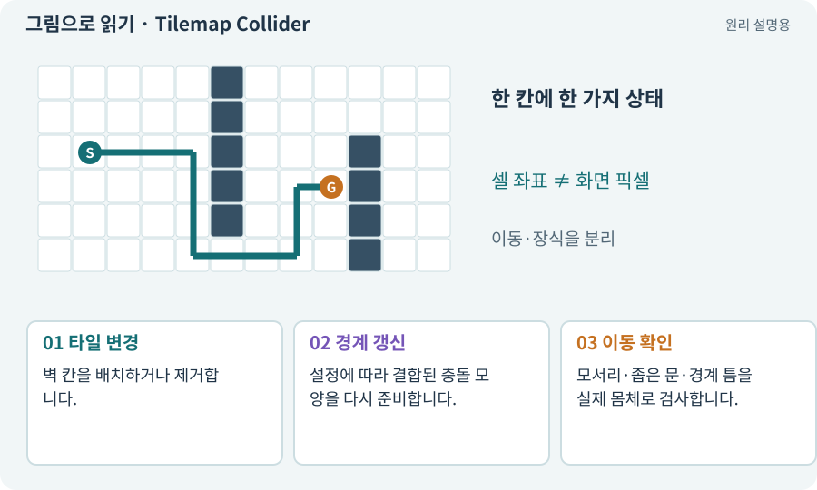

# Tilemap Collider·Composite Collider

**분야:** 지도·적 AI·전투 규칙

Tilemap Collider 2D는 타일의 충돌 모양을 만들고, Composite Collider 2D는 여러 모양을 결합하는 데 사용합니다. 타일 변경과 충돌 갱신 완료 시점도 고려해야 합니다.

**찾아오는 이름:** Tilemap Collider·Composite Collider, Tilemap Collider, TilemapCollider2D, Composite Collider, CompositeCollider2D, WallsCollision

## 익숙한 것에 비유하면

작은 벽돌마다 경계선을 따로 두는 대신 이어진 벽의 바깥 윤곽을 만드는 것입니다.



개념도입니다. 실제 Unity 화면이나 검사 결과가 아닙니다. 그림의 순서·색은 역할을 구분하며 실제 설정값은 프로젝트에서 확인합니다.

## 이렇게 작동합니다

### 1. 타일 변경

벽 칸을 배치하거나 제거합니다.

### 2. 경계 갱신

설정에 따라 결합된 충돌 모양을 다시 준비합니다.

### 3. 이동 확인

모서리·좁은 문·경계 틈을 실제 몸체로 검사합니다.

## 우리 RPG에서는 이렇게 만나요

런타임 랜덤맵을 그린 즉시 적을 움직이면 새 충돌 상태가 아직 준비되지 않았을 수 있습니다. 준비 완료 뒤 스폰·경로 검사를 진행합니다.

## 이것과 혼동하지 마세요

Composite를 추가했다고 모든 타일 경계 문제가 사라지지는 않습니다. 모양·Rigidbody2D·조합 설정을 확인합니다.

## 이해했는지 한 번 생각해 보기

새 벽 그림이 보이는데 첫 프레임에 통과한다면?

<details><summary>답과 이유</summary>

충돌 갱신과 이동 시작의 순서가 맞는지 조사합니다.

</details>

## 내 프로젝트에서 확인하고 싶다면

아래 요청은 읽기 전용으로 실제 대상을 확인하는 선택 요청입니다. 코드나 설정을 직접 편집할 필요는 없습니다.

```text
현재 프로젝트에서 Tilemap Collider·Composite Collider 관련 요소가 어떻게 사용되는지 읽기 전용으로 확인해 줘. 실제 대상과 설정을 찾아 쉬운 말과 작은 예로 설명해 줘. 특히 다음 혼동을 구분해 줘: Composite를 추가했다고 모든 타일 경계 문제가 사라지지는 않습니다. 모양·Rigidbody2D·조합 설정을 확인합니다. 아직 코드·설정·파일은 바꾸지 말고, 확인할 수 없는 내용은 따로 알려 줘.
```

## 이어지는 개념

[Tilemap·Tile·타일 팔레트](tilemap.md) · [Collider와 몸체 경계](collider.md) · [수명주기·초기화·정리](lifecycle.md) · [절차적·무작위 지형 생성](generation.md)

## 이 개념을 사용하는 실습

[07 · 캐릭터와 벽이 있는 공간 만들기](../index.html#lesson-007) · [28 · 여덟 구역의 첫 던전 만들기](../index.html#lesson-028) · [46 · 랜덤 지도 위를 실제로 걷기](../index.html#lesson-046) · [66 · 타일 경계와 랜덤맵 외형 연결하기](../index.html#lesson-066) · [143 · 새 랜덤 지역 봉인된 대장간 만들기](../index.html#lesson-143)

## 참고와 설명의 범위

기본 도구 동작은 아래 공식 자료를 참고했습니다. 비유·그림·RPG의 예시 수치와 정책은 이해를 위한 자체 예제입니다. 실제 API·지원 기능은 설치 버전과 계정에서 확인합니다.

- [Unity · Tilemap Collider 2D](https://docs.unity3d.com/6000.3/Documentation/Manual/tilemaps/work-with-tilemaps/tilemap-collider-2d.html)

그림·계산 예제·조작 모형은 자체 제작한 설명입니다. 실제 Unity 화면, 서비스 생성 결과, 성능 실측 또는 게임 테스트 결과가 아닙니다. 자료 확인: 2026년 9월 26일.
