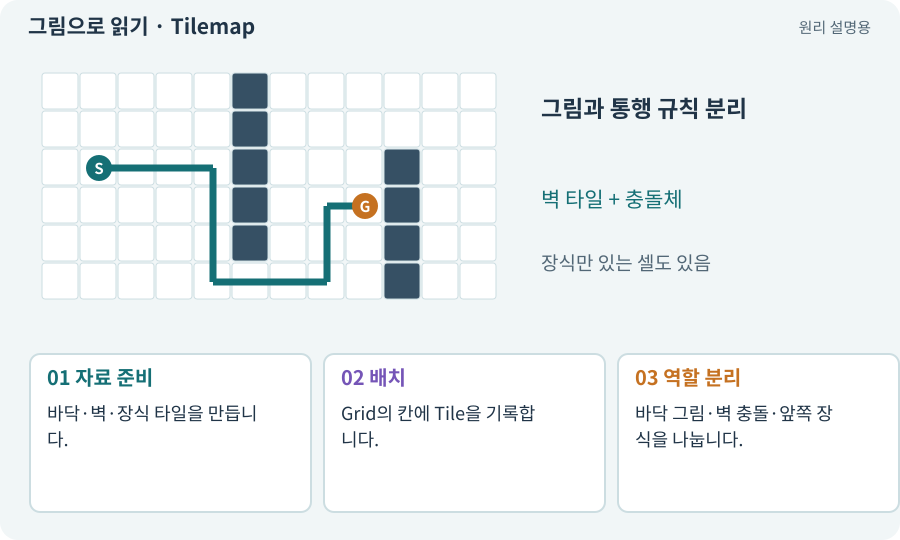

# Tilemap·Tile·타일 팔레트

**분야:** 지도·적 AI·전투 규칙

Tile은 칸에 놓을 그림과 속성을 가진 자료이고, Tilemap은 많은 칸의 타일 배치를 관리하는 컴포넌트입니다. 팔레트는 타일을 고르는 목록이며 생성 규칙 자체는 아닙니다.

**찾아오는 이름:** Tilemap·Tile·타일 팔레트, Tilemap, 타일맵, Tile, 타일, 타일 팔레트

## 익숙한 것에 비유하면

타일은 벽돌 종류, Tilemap은 벽돌을 쌓은 설계 배치입니다. 설계도에서 벽돌 종류를 골랐다고 건물 전체가 완성되는 것은 아닙니다.



개념도입니다. 실제 Unity 화면이나 검사 결과가 아닙니다. 그림의 순서·색은 역할을 구분하며 실제 설정값은 프로젝트에서 확인합니다.

## 이렇게 작동합니다

### 1. 자료 준비

바닥·벽·장식 타일을 만듭니다.

### 2. 배치

Grid의 칸에 Tile을 기록합니다.

### 3. 역할 분리

바닥 그림·벽 충돌·앞쪽 장식을 나눕니다.

## 우리 RPG에서는 이렇게 만나요

우리 게임에서는 Floor와 WallsCollision, WallArt처럼 표시와 충돌을 분리할 수 있습니다. 풍성한 벽 그림이 통로 전체를 막는 충돌체가 되지 않게 합니다.

## 이것과 혼동하지 마세요

예쁜 바닥 그림을 놓았다고 A*의 이동 가능 칸도 자동 갱신되지는 않습니다.

## 이해했는지 한 번 생각해 보기

벽을 지웠는데 아직 막히는 이유는?

<details><summary>답과 이유</summary>

충돌용 타일이나 경로 데이터가 예전 상태일 수 있습니다.

</details>

## 내 프로젝트에서 확인하고 싶다면

아래 요청은 읽기 전용으로 실제 대상을 확인하는 선택 요청입니다. 코드나 설정을 직접 편집할 필요는 없습니다.

```text
현재 프로젝트에서 Tilemap·Tile·타일 팔레트 관련 요소가 어떻게 사용되는지 읽기 전용으로 확인해 줘. 실제 대상과 설정을 찾아 쉬운 말과 작은 예로 설명해 줘. 특히 다음 혼동을 구분해 줘: 예쁜 바닥 그림을 놓았다고 A*의 이동 가능 칸도 자동 갱신되지는 않습니다. 아직 코드·설정·파일은 바꾸지 말고, 확인할 수 없는 내용은 따로 알려 줘.
```

## 이어지는 개념

[Grid·셀·격자 좌표](grid.md) · [Tilemap Collider·Composite Collider](tile-collider.md) · [Sorting Layer·Order·발 정렬](sorting.md) · [자동 타일링·Rule Tile·경계 마스크](autotile.md)

## 이 개념을 사용하는 실습

[01 · 빈 2D 프로젝트 만들기](../index.html#lesson-001) · [07 · 캐릭터와 벽이 있는 공간 만들기](../index.html#lesson-007) · [09 · 클릭한 곳까지 벽을 돌아가기](../index.html#lesson-009) · [28 · 여덟 구역의 첫 던전 만들기](../index.html#lesson-028) · [33 · 기본 캐릭터·몬스터·타일 아트 만들기](../index.html#lesson-033) · [35 · 앞뒤 가림과 PC 조작 다듬기](../index.html#lesson-035) · [44 · 시드로 같은 던전 다시 만들기](../index.html#lesson-044) · [46 · 랜덤 지도 위를 실제로 걷기](../index.html#lesson-046) · [47 · 실패하는 시드를 찾고 복구하기](../index.html#lesson-047) · [55 · 어떤 그림도 맞춰 넣는 아트 규격 정하기](../index.html#lesson-055) · [56 · Unity AI로 캐릭터 움직임 만들기](../index.html#lesson-056) · [57 · Unity AI로 바닥과 벽 타일 만들기](../index.html#lesson-057) · [58 · PixelLab로 방향별 픽셀 캐릭터 만들기](../index.html#lesson-058) · [59 · Retro Diffusion으로 캐릭터와 타일 만들기](../index.html#lesson-059) · [60 · Scenario로 스타일과 동작 유지하기](../index.html#lesson-060) · [62 · OpenAI 이미지로 게임 자산 만들기](../index.html#lesson-062) · [63 · Grok 이미지로 같은 자산 시험하기](../index.html#lesson-063) · [65 · 스프라이트를 정리해 실제 캐릭터에 넣기](../index.html#lesson-065) · [66 · 타일 경계와 랜덤맵 외형 연결하기](../index.html#lesson-066) · [67 · 내 게임의 아트 제작 경로 선택하기](../index.html#lesson-067) · [73 · 주소로 에셋 불러오기](../index.html#lesson-073) · [74 · 추가 외형을 서버에서 받게 준비하기](../index.html#lesson-074) · [79 · 추가 기능을 하나의 게임으로 합치기](../index.html#lesson-079) · [84 · 같은 지도를 3D 바닥과 벽으로 만들기](../index.html#lesson-084) · [95 · 3D 조명과 환경을 읽기 좋게 만들기](../index.html#lesson-095) · [137 · 기름·폭발통·밸브로 공간 활용하기](../index.html#lesson-137) · [147 · 용광로 감시자와 3단계 전투 만들기](../index.html#lesson-147) · [148 · 아트 역할로 새 지역 외형 완성하기](../index.html#lesson-148) · [153 · 대장간 고해상도팩 선택 다운로드하기](../index.html#lesson-153)

## 참고와 설명의 범위

기본 도구 동작은 아래 공식 자료를 참고했습니다. 비유·그림·RPG의 예시 수치와 정책은 이해를 위한 자체 예제입니다. 실제 API·지원 기능은 설치 버전과 계정에서 확인합니다.

- [Unity · Tilemap Collider 2D](https://docs.unity3d.com/6000.3/Documentation/Manual/tilemaps/work-with-tilemaps/tilemap-collider-2d.html)

그림·계산 예제·조작 모형은 자체 제작한 설명입니다. 실제 Unity 화면, 서비스 생성 결과, 성능 실측 또는 게임 테스트 결과가 아닙니다. 자료 확인: 2026년 9월 26일.
