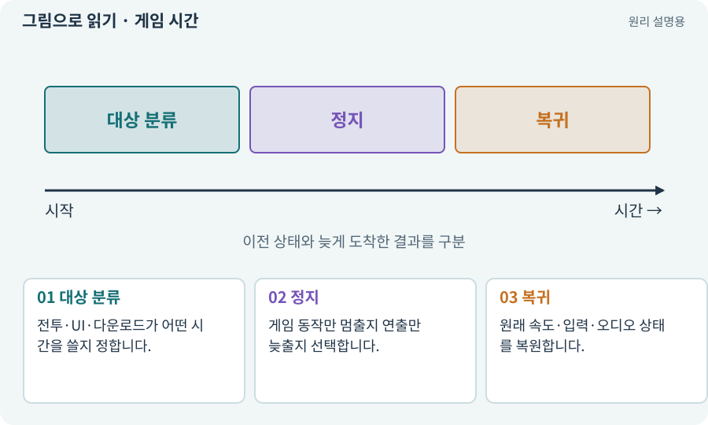

# 게임 시간·실시간·일시정지

**분야:** 오브젝트·좌표·움직임

게임 시간은 일시정지나 느린 연출에 따라 흐름을 조절할 수 있습니다. 실시간은 그와 별개로 흐르며 메뉴·다운로드·일부 UI에 필요합니다.

**찾아오는 이름:** 게임 시간·실시간·일시정지, timeScale, Time.timeScale, unscaledTime, 일시정지, Pause, 히트스톱, hit stop

## 익숙한 것에 비유하면

영화를 멈춰도 리모컨과 다운로드 시계는 움직이는 것과 같습니다.



개념도입니다. 실제 Unity 화면이나 검사 결과가 아닙니다. 그림의 순서·색은 역할을 구분하며 실제 설정값은 프로젝트에서 확인합니다.

## 이렇게 작동합니다

### 1. 대상 분류

전투·UI·다운로드가 어떤 시간을 쓸지 정합니다.

### 2. 정지

게임 동작만 멈출지 연출만 늦출지 선택합니다.

### 3. 복귀

원래 속도·입력·오디오 상태를 복원합니다.

## 우리 RPG에서는 이렇게 만나요

타격감을 위해 잠깐 정지하는 히트스톱은 유용할 수 있지만 모바일 공격 버튼까지 멈추거나 다운로드 타임아웃이 정지하면 안 됩니다. 정지 중 입력 버퍼 처리도 정합니다.

## 이것과 혼동하지 마세요

timeScale=0이 모든 코드를 자동 정지시키지는 않습니다. Update 호출과 비동기 작업·실시간 UI 등은 별도로 봅니다.

## 이해했는지 한 번 생각해 보기

게임을 멈추면 네트워크 요청도 반드시 멈출까요?

<details><summary>답과 이유</summary>

아닙니다. 네트워크와 실시간 작업의 수명주기·취소를 별도로 처리합니다.

</details>

## 내 프로젝트에서 확인하고 싶다면

아래 요청은 읽기 전용으로 실제 대상을 확인하는 선택 요청입니다. 코드나 설정을 직접 편집할 필요는 없습니다.

```text
현재 프로젝트에서 게임 시간·실시간·일시정지 관련 요소가 어떻게 사용되는지 읽기 전용으로 확인해 줘. 실제 대상과 설정을 찾아 쉬운 말과 작은 예로 설명해 줘. 특히 다음 혼동을 구분해 줘: timeScale=0이 모든 코드를 자동 정지시키지는 않습니다. Update 호출과 비동기 작업·실시간 UI 등은 별도로 봅니다. 아직 코드·설정·파일은 바꾸지 말고, 확인할 수 없는 내용은 따로 알려 줘.
```

## 이어지는 개념

[deltaTime과 초당 속도](delta-time.md) · [비동기·await·콜백](async.md) · [쿨다운·마나·자원 소비](cooldown.md) · [수명주기·초기화·정리](lifecycle.md)

## 이 개념을 사용하는 실습

[08 · WASD로 벽에 부딪히며 이동하기](../index.html#lesson-008) · [10 · 모바일 조이스틱과 버튼 배치하기](../index.html#lesson-010) · [19 · 누가 때렸는지 보이는 전투 만들기](../index.html#lesson-019) · [24 · 보기 편한 인벤토리 화면 만들기](../index.html#lesson-024) · [25 · 게임을 껐다 켜도 장비 유지하기](../index.html#lesson-025) · [26 · 새 게임·이어하기·마을 연결하기](../index.html#lesson-026) · [34 · 걷기·공격·피격·사망 움직임 연결하기](../index.html#lesson-034) · [36 · 휴대폰에서 두 손가락으로 전투하기](../index.html#lesson-036) · [38 · 테스트 결과와 실제 플레이 구분하기](../index.html#lesson-038) · [42 · 트리에서 투자하고 저장하기](../index.html#lesson-042) · [51 · 전투 전체의 압박 조절하기](../index.html#lesson-051) · [53 · 입력은 빠르게, 취소 규칙은 명확하게](../index.html#lesson-053) · [71 · 카메라·소리·피해 숫자 맞추기](../index.html#lesson-071) · [85 · 3D 캐릭터를 한 모터로 움직이기](../index.html#lesson-085) · [88 · 3D 모델에 걷기와 공격 연결하기](../index.html#lesson-088) · [89 · 같은 전투 규칙을 3D에 연결하기](../index.html#lesson-089) · [96 · 3D 카메라 가림과 터치 조작 다듬기](../index.html#lesson-096) · [134 · 화상·냉기·표식으로 전투 확장하기](../index.html#lesson-134) · [150 · 소리가 없어도 읽히는 전투 만들기](../index.html#lesson-150)

## 참고와 설명의 범위

기본 도구 동작은 아래 공식 자료를 참고했습니다. 비유·그림·RPG의 예시 수치와 정책은 이해를 위한 자체 예제입니다. 실제 API·지원 기능은 설치 버전과 계정에서 확인합니다.

- [Unity · GameObject와 컴포넌트](https://docs.unity3d.com/6000.3/Documentation/Manual/GameObjects.html)

그림·계산 예제·조작 모형은 자체 제작한 설명입니다. 실제 Unity 화면, 서비스 생성 결과, 성능 실측 또는 게임 테스트 결과가 아닙니다. 자료 확인: 2026년 9월 26일.
