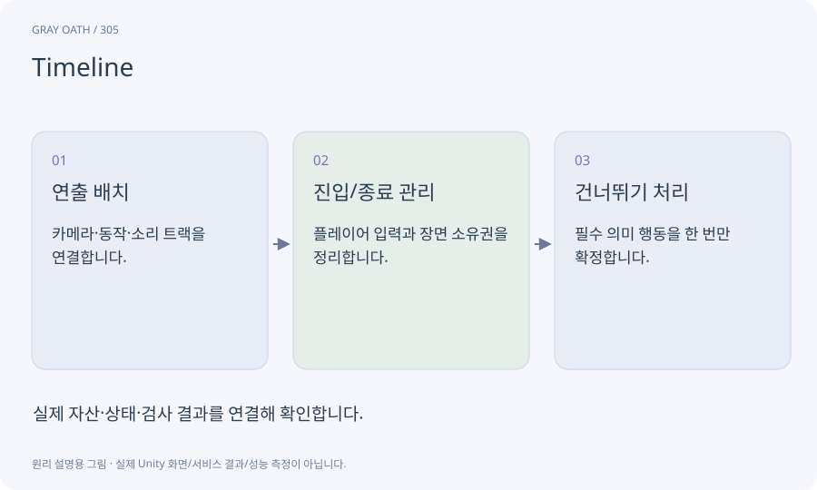

# Timeline

애니메이션·카메라·오디오 같은 연출을 시간축에 배치하는 Unity 도구입니다. 연출의 재생 시점과 게임의 중요한 사실 확정은 분리하는 것이 안전합니다.

## 익숙한 비유

여러 악기가 언제 들어오는지 정한 악보입니다. 관객이 중간에 건너뛰어도 이야기의 결과는 일관돼야 합니다.



## 작동 원리

### 1. 연출 배치

카메라·동작·소리 트랙을 연결합니다.

### 2. 진입/종료 관리

플레이어 입력과 장면 소유권을 정리합니다.

### 3. 건너뛰기 처리

필수 의미 행동을 한 번만 확정합니다.

## 게임 속 예

20초 도입 장면을0초·중간·끝에서 건너뛰어도 퀘스트 시작 사실과 카메라 반환은 한 번씩 같아야 합니다.

## 혼동하지 않기

시그널을 유일한 보상/퀘스트 커밋 수단으로 쓰면 건너뛰기에 의해 누락·중복될 수 있습니다.

## 확인 질문

컷신을 끄면 메인 퀘스트를 시작할 수 없나요?

그렇지 않게 연출과 의미 커밋을 분리합니다.

## 내 프로젝트에서 확인하기

```text
현재 GrayOathRPG3D에서 Timeline을 사용하는 실제 대상과 동작을 읽기 전용으로 확인해 줘. 쉬운 말과 작은 사례로 설명하고 시그널을 유일한 보상/퀘스트 커밋 수단으로 쓰면 건너뛰기에 의해 누락·중복될 수 있습니다. 이 문제를 어떻게 막는지 보여 줘. 코드·데이터·설정은 아직 수정하지 마.
```

## 관련 해설

[cutscene-commit](cutscene-commit.md) · [cinemachine](cinemachine.md) · [audio](audio.md)

## 공식 참고

- [Unity · Timeline](https://docs.unity3d.com/Packages/com.unity.timeline@1.8/manual/index.html)
