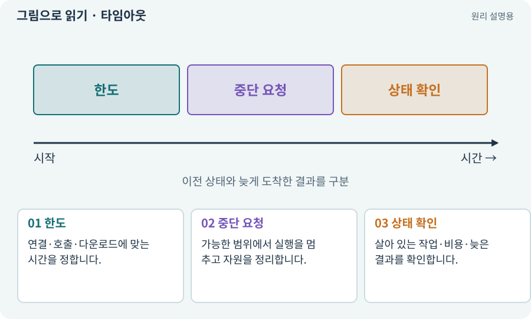

# 타임아웃·중단·취소

**분야:** AI·스킬·훅·하네스 운영

타임아웃은 정한 시간 안에 끝나지 않은 작업을 제한하는 규칙입니다. 취소는 더 이상 결과를 원하지 않는다는 요청이며 실제 외부 작업이 즉시 멈추는지는 따로 확인합니다.

**찾아오는 이름:** 타임아웃·중단·취소, 타임아웃, Timeout, 시간 제한, cancel

## 익숙한 것에 비유하면

식당 주문을 취소해도 이미 불에 올린 음식이 순간적으로 사라지는 것은 아닙니다.



개념도입니다. 실제 Unity 화면이나 검사 결과가 아닙니다. 그림의 순서·색은 역할을 구분하며 실제 설정값은 프로젝트에서 확인합니다.

## 이렇게 작동합니다

### 1. 한도

연결·호출·다운로드에 맞는 시간을 정합니다.

### 2. 중단 요청

가능한 범위에서 실행을 멈추고 자원을 정리합니다.

### 3. 상태 확인

살아 있는 작업·비용·늦은 결과를 확인합니다.

## 우리 RPG에서는 이렇게 만나요

Unity 빌드가 오래 걸린다고 AI가 새 빌드를 반복 실행하면 프로세스가 겹칠 수 있습니다. 현재 작업 상태를 확인한 뒤 복구합니다.

## 이것과 혼동하지 마세요

타임아웃을 무조건 실패 없음으로 바꾸거나 한도를 자동으로 무한 늘리지 않습니다.

## 이해했는지 한 번 생각해 보기

요청을 취소했으니 과금도 0원인가요?

<details><summary>답과 이유</summary>

이미 수행된 작업은 비용이 발생했을 수 있어 실제 사용량을 확인해야 합니다.

</details>

## 내 프로젝트에서 확인하고 싶다면

아래 요청은 읽기 전용으로 실제 대상을 확인하는 선택 요청입니다. 코드나 설정을 직접 편집할 필요는 없습니다.

```text
현재 프로젝트에서 타임아웃·중단·취소 관련 요소가 어떻게 사용되는지 읽기 전용으로 확인해 줘. 실제 대상과 설정을 찾아 쉬운 말과 작은 예로 설명해 줘. 특히 다음 혼동을 구분해 줘: 타임아웃을 무조건 실패 없음으로 바꾸거나 한도를 자동으로 무한 늘리지 않습니다. 아직 코드·설정·파일은 바꾸지 말고, 확인할 수 없는 내용은 따로 알려 줘.
```

## 이어지는 개념

[프로세스·종료 코드·표준 출력](process.md) · [비용 한도·예약·실사용량](budget.md) · [요청 ID·세대 ID·오래된 응답](request-id.md) · [취소 신호·늦은 완료·정리](cancellation.md)

## 이 개념을 사용하는 실습

[10 · 모바일 조이스틱과 버튼 배치하기](../index.html#lesson-010) · [114 · 테스트를 실행하고 결과 읽기](../index.html#lesson-114) · [117 · Unity 작업을 한 창구로 모으기](../index.html#lesson-117) · [118 · 모의 응답 대신 실제 Claude 연결하기](../index.html#lesson-118)

## 참고와 설명의 범위

기본 도구 동작은 아래 공식 자료를 참고했습니다. 비유·그림·RPG의 예시 수치와 정책은 이해를 위한 자체 예제입니다. 실제 API·지원 기능은 설치 버전과 계정에서 확인합니다.

- [Python · subprocess](https://docs.python.org/3/library/subprocess.html)

그림·계산 예제·조작 모형은 자체 제작한 설명입니다. 실제 Unity 화면, 서비스 생성 결과, 성능 실측 또는 게임 테스트 결과가 아닙니다. 자료 확인: 2026년 9월 26일.
