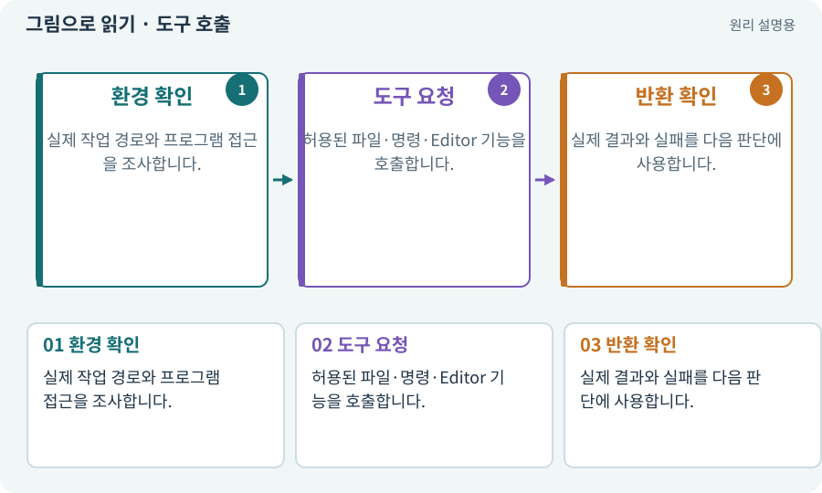

# 도구 호출·로컬·클라우드

**분야:** AI·스킬·훅·하네스 운영

도구 호출은 모델의 말이 실제 파일·프로세스·브라우저·Editor 작업으로 이어지는 요청입니다. 로컬은 내 컴퓨터, 클라우드는 다른 서버의 작업 환경을 뜻하므로 경로와 권한이 다릅니다.

**찾아오는 이름:** 도구 호출·로컬·클라우드, 도구 호출, Tool Call, 로컬, 클라우드, local, 로컬 연결

## 익숙한 것에 비유하면

원격으로 다른 공장의 로봇을 조작하는 것과 내 책상 위 공구를 쓰는 차이입니다.



개념도입니다. 실제 Unity 화면이나 검사 결과가 아닙니다. 그림의 순서·색은 역할을 구분하며 실제 설정값은 프로젝트에서 확인합니다.

## 이렇게 작동합니다

### 1. 환경 확인

실제 작업 경로와 프로그램 접근을 조사합니다.

### 2. 도구 요청

허용된 파일·명령·Editor 기능을 호출합니다.

### 3. 반환 확인

실제 결과와 실패를 다음 판단에 사용합니다.

## 우리 RPG에서는 이렇게 만나요

웹 채팅에 프로젝트 이름을 썼다고 내 PC의 Unity가 연결되는 것은 아닙니다. AI가 실제 파일 목록·Editor 경로를 읽어 확인하게 합니다.

## 이것과 혼동하지 마세요

클라우드 임시 폴더에서 만든 파일과 사용자 PC의 파일을 같은 것으로 말하지 않습니다.

## 이해했는지 한 번 생각해 보기

“Unity를 열어 줘”라는 말만으로 항상 가능할까요?

<details><summary>답과 이유</summary>

실제 로컬 도구와 권한이 연결되어 있어야 합니다.

</details>

## 내 프로젝트에서 확인하고 싶다면

아래 요청은 읽기 전용으로 실제 대상을 확인하는 선택 요청입니다. 코드나 설정을 직접 편집할 필요는 없습니다.

```text
현재 프로젝트에서 도구 호출·로컬·클라우드 관련 요소가 어떻게 사용되는지 읽기 전용으로 확인해 줘. 실제 대상과 설정을 찾아 쉬운 말과 작은 예로 설명해 줘. 특히 다음 혼동을 구분해 줘: 클라우드 임시 폴더에서 만든 파일과 사용자 PC의 파일을 같은 것으로 말하지 않습니다. 아직 코드·설정·파일은 바꾸지 말고, 확인할 수 없는 내용은 따로 알려 줘.
```

## 이어지는 개념

[API와 매개변수](api.md) · [CLI와 GUI](cli.md) · [권한·승인·최소 권한](permission.md) · [프로세스·종료 코드·표준 출력](process.md)

## 이 개념을 사용하는 실습

[01 · 빈 2D 프로젝트 만들기](../index.html#lesson-001) · [02 · 내 게임을 알아듣는 개발 스킬 만들기](../index.html#lesson-002) · [03 · AI와 실행 중인 Unity 연결하기](../index.html#lesson-003) · [04 · 되돌릴 수 있는 작업 습관 만들기](../index.html#lesson-004) · [39 · 다른 PC와 Android 에서 실행할 파일 만들기](../index.html#lesson-039) · [52 · 전투에서 선택할 이유 만들기](../index.html#lesson-052) · [54 · 느낌을 근거로 밸런스 고치기](../index.html#lesson-054) · [64 · 추가 결제 없이 AI로 2D 프레임 만들기](../index.html#lesson-064) · [73 · 주소로 에셋 불러오기](../index.html#lesson-073) · [74 · 추가 외형을 서버에서 받게 준비하기](../index.html#lesson-074) · [76 · 연결이 끊겨도 게임 계속하기](../index.html#lesson-076) · [78 · 선택: Google Play 에셋 전달 사용하기](../index.html#lesson-078) · [79 · 추가 기능을 하나의 게임으로 합치기](../index.html#lesson-079) · [99 · 2D와 3D 사이에 진행 가져오기](../index.html#lesson-099) · [105 · 내 개발 도구를 빈 폴더에서 시작하기](../index.html#lesson-105) · [128 · 내 도구를 대화로 운영하기](../index.html#lesson-128) · [140 · 개인 창고와 즐겨찾기 만들기](../index.html#lesson-140) · [153 · 대장간 고해상도팩 선택 다운로드하기](../index.html#lesson-153) · [155 · 기록을 보고 제작 경제와 전투 조정하기](../index.html#lesson-155) · [157 · 하네스가 실패해도 기록 지키기](../index.html#lesson-157) · [159 · 최종 확장판 배포 후보 만들기](../index.html#lesson-159)

## 참고와 설명의 범위

기본 도구 동작은 아래 공식 자료를 참고했습니다. 비유·그림·RPG의 예시 수치와 정책은 이해를 위한 자체 예제입니다. 실제 API·지원 기능은 설치 버전과 계정에서 확인합니다.

- [Claude Code · CLI 명령 옵션](https://code.claude.com/docs/en/cli-reference)

그림·계산 예제·조작 모형은 자체 제작한 설명입니다. 실제 Unity 화면, 서비스 생성 결과, 성능 실측 또는 게임 테스트 결과가 아닙니다. 자료 확인: 2026년 9월 26일.
