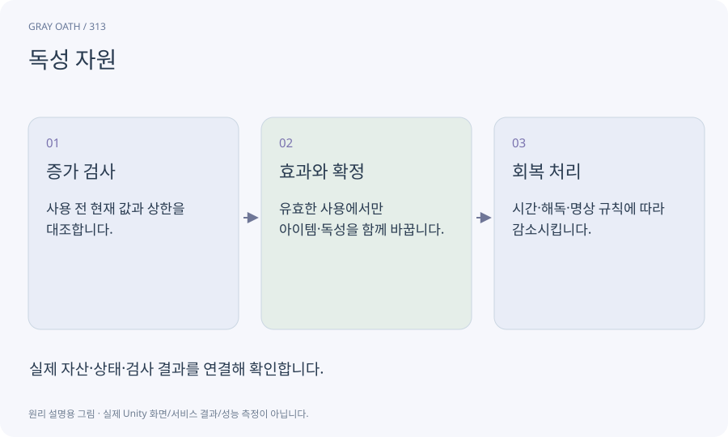

# 독성 자원

포션 같은 강한 효과를 연속 사용했을 때 부담을 주는 별도 자원입니다. 체력·마나·쿨다운과 독립적으로 사용 가능 여부를 정합니다.

## 익숙한 비유

몸이 한꺼번에 처리할 수 있는 약의 양을 게임 규칙으로 단순화한 게이지입니다. 실제 의학 정보가 아닙니다.



## 작동 원리

### 1. 증가 검사

사용 전 현재 값과 상한을 대조합니다.

### 2. 효과와 확정

유효한 사용에서만 아이템·독성을 함께 바꿉니다.

### 3. 회복 처리

시간·해독·명상 규칙에 따라 감소시킵니다.

## 게임 속 예

독성0~100의 설계에서 포션이25를 더하는데 현재90이면 사용을 거부하거나 별도로 정의한 초과 규칙을 적용합니다. 이 과정은 거부 정책으로 시작합니다.

## 혼동하지 않기

UI만 막고 실제 인벤토리를 차감하면 안 됩니다. 실제 약물 용량처럼 해석하지 않습니다.

## 확인 질문

해독제를 연타하면 값이 음수가 되나요?

0~100 불변조건과 원자적 거래로 막고 실제 사용 여부를 표시합니다.

## 내 프로젝트에서 확인하기

```text
현재 GrayOathRPG3D에서 독성 자원을 사용하는 실제 대상과 동작을 읽기 전용으로 확인해 줘. 쉬운 말과 작은 사례로 설명하고 UI만 막고 실제 인벤토리를 차감하면 안 됩니다. 실제 약물 용량처럼 해석하지 않습니다. 이 문제를 어떻게 막는지 보여 줘. 코드·데이터·설정은 아직 수정하지 마.
```

## 관련 해설

[alchemy](alchemy.md) · [invariant](invariant.md) · [transaction](transaction.md)

## 공식 참고

- [Unity · AssetDatabase](https://docs.unity3d.com/6000.3/Documentation/ScriptReference/AssetDatabase.html)
