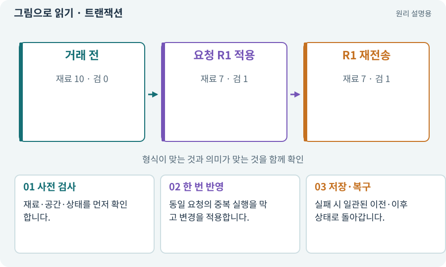

# 트랜잭션·거래의 한 번 적용

**분야:** 코드·데이터·저장·검사

트랜잭션은 여러 변경을 하나의 논리적 거래로 묶는 방법입니다. 제작이라면 재료 차감과 장비 지급이 함께 성공하거나 함께 실패해야 합니다. Git 커밋과는 문맥이 다릅니다.

**찾아오는 이름:** 트랜잭션·거래의 한 번 적용, 트랜잭션, Transaction, 거래, 원자적 처리, commit, 커밋

## 익숙한 것에 비유하면

자판기가 돈만 받고 상품을 안 주거나 상품만 주고 돈을 안 받는 일을 막는 규칙입니다.



개념도입니다. 실제 Unity 화면이나 검사 결과가 아닙니다. 그림의 순서·색은 역할을 구분하며 실제 설정값은 프로젝트에서 확인합니다.

## 이렇게 작동합니다

### 1. 사전 검사

재료·공간·상태를 먼저 확인합니다.

### 2. 한 번 반영

동일 요청의 중복 실행을 막고 변경을 적용합니다.

### 3. 저장·복구

실패 시 일관된 이전·이후 상태로 돌아갑니다.

## 버튼 연타와 저장 실패를 함께 생각하세요

제작 요청은 먼저 레시피·해금·재료·가방 공간을 확인합니다. 그다음 재료 차감과 결과 아이템 추가를 하나의 변경으로 계산합니다. 반만 적용된 상태가 사용자에게 노출되지 않도록 합니다.

요청 ID를 저장해 같은 요청이 다시 오면 새 지급을 하지 않는 방식으로 멱등성을 구현할 수 있습니다. 새로 누른 별도 제작은 새 요청이므로 재료가 있으면 다시 수행할 수 있습니다. 서로 다른 두 요청까지 한 요청으로 합치면 안 됩니다.

아래 모형은 재료 10, 제작 비용 3으로 시작합니다. “같은 요청 다시 보내기”는 이미 적용한 거래를 반복합니다. 이것은 저장 장치의 전원 장애까지 검증하는 도구가 아닙니다.

| 단계 | 성공 시 | 실패 시 |
| --- | --- | --- |
| 사전 확인 | 거래 후보 계산 | 변경 없음 |
| 일괄 적용 | 재료와 결과 함께 변경 | 반쪽 변경 금지 |
| 중복 요청 | 기존 결과 반환 | 새 아이템 지급 금지 |

## 직접 값을 바꾸며 보기

[웹 해설의 조작 모형 열기](../index.html#tech-transaction). 조작은 설명용 모형만 바꿉니다. 실제 프로젝트·AI·진행 체크·게임 테스트는 실행하거나 변경하지 않습니다.

## 우리 RPG에서는 이렇게 만나요

가방이 꽉 차면 제작 장비를 넣을 수 있는지 확인한 뒤 재료를 차감해야 합니다. 재료 차감부터 하고 저장이 실패하면 복구 정책이 필요합니다.

## 이것과 혼동하지 마세요

함수 이름을 Commit이라고 붙인 것만으로 원자성·내구성이 보장되지는 않습니다.

## 이해했는지 한 번 생각해 보기

같은 제작 버튼을 두 번 눌러도 재료가 한 번만 빠지게 하려면?

<details><summary>답과 이유</summary>

요청 ID·현재 상태·적용 기록을 묶어 중복 거래를 거부합니다.

</details>

## 내 프로젝트에서 확인하고 싶다면

아래 요청은 읽기 전용으로 실제 대상을 확인하는 선택 요청입니다. 코드나 설정을 직접 편집할 필요는 없습니다.

```text
현재 프로젝트에서 트랜잭션·거래의 한 번 적용 관련 요소가 어떻게 사용되는지 읽기 전용으로 확인해 줘. 실제 대상과 설정을 찾아 쉬운 말과 작은 예로 설명해 줘. 특히 다음 혼동을 구분해 줘: 함수 이름을 Commit이라고 붙인 것만으로 원자성·내구성이 보장되지는 않습니다. 아직 코드·설정·파일은 바꾸지 말고, 확인할 수 없는 내용은 따로 알려 줘.
```

## 이어지는 개념

[멱등성·재시도해도 한 번](idempotency.md) · [불변 조건·경계값·속성 검사](invariant.md) · [파일 저장·게임 세이브·백업](save.md) · [아이템 인스턴스와 소유권](item-instance.md)

## 이 개념을 사용하는 실습

[27 · 회복하고 물약을 사는 마을 만들기](../index.html#lesson-027) · [38 · 테스트 결과와 실제 플레이 구분하기](../index.html#lesson-038) · [138 · 장비를 분해해 재료 얻기](../index.html#lesson-138) · [139 · 재료로 장비 제작하기](../index.html#lesson-139) · [140 · 개인 창고와 즐겨찾기 만들기](../index.html#lesson-140) · [141 · 소켓 한 칸에 룬 장착하기](../index.html#lesson-141) · [144 · 이번 탐험에만 남는 유물 고르기](../index.html#lesson-144) · [146 · 대장장이 구조 퀘스트 만들기](../index.html#lesson-146) · [152 · 이전 저장을 새 확장판으로 가져오기](../index.html#lesson-152) · [155 · 기록을 보고 제작 경제와 전투 조정하기](../index.html#lesson-155) · [156 · 기능 조합에서 숨은 오류 찾기](../index.html#lesson-156) · [158 · 룬 교체 버그를 역할로 수정하기](../index.html#lesson-158)

## 참고와 설명의 범위

이 항목의 비유·그림·RPG 수치·운영 규칙은 개념을 이해하기 위한 자체 설계 예제입니다. 특정 도구가 이 규칙을 자동으로 구현한다는 뜻은 아닙니다.


그림·계산 예제·조작 모형은 자체 제작한 설명입니다. 실제 Unity 화면, 서비스 생성 결과, 성능 실측 또는 게임 테스트 결과가 아닙니다. 자료 확인: 2026년 9월 26일.
