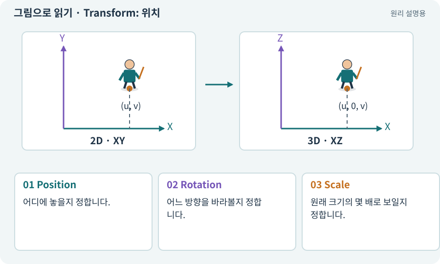

# Transform: 위치·회전·크기

**분야:** 오브젝트·좌표·움직임

Transform은 객체의 위치·회전·크기와 부모 관계를 표현합니다. 2D 게임의 객체도 Transform 자체는 3차원 값을 가집니다.

**찾아오는 이름:** Transform: 위치·회전·크기, Transform, 트랜스폼, Position, Rotation, Scale, position, rotation, localScale, Quaternion, 회전값

## 익숙한 것에 비유하면

종이 인형을 책상 위 어디에 놓고 어느 방향으로 돌리며 얼마나 확대할지 정하는 세 가지 손잡이입니다.



개념도입니다. 실제 Unity 화면이나 검사 결과가 아닙니다. 그림의 순서·색은 역할을 구분하며 실제 설정값은 프로젝트에서 확인합니다.

## 이렇게 작동합니다

### 1. Position

어디에 놓을지 정합니다.

### 2. Rotation

어느 방향을 바라볼지 정합니다.

### 3. Scale

원래 크기의 몇 배로 보일지 정합니다.

## 우리 RPG에서는 이렇게 만나요

탑다운 2D에서 이동은 XY를 쓰고 Z는 같은 값으로 유지합니다. 그림을 2배 키우려면 VisualRoot만 바꾸고 발 주변 몸체 반경은 그대로 둘 수 있습니다.

## 이것과 혼동하지 마세요

물리 몸체를 가진 캐릭터의 Transform을 매번 직접 옮기면 모터·물리 계산과 어긋날 수 있습니다.

## 이해했는지 한 번 생각해 보기

Scale을 키우면 공격 사거리가 자동으로 커져야 하나요?

<details><summary>답과 이유</summary>

아닙니다. 사거리의 설계 데이터와 외형 크기는 별도입니다.

</details>

## 내 프로젝트에서 확인하고 싶다면

아래 요청은 읽기 전용으로 실제 대상을 확인하는 선택 요청입니다. 코드나 설정을 직접 편집할 필요는 없습니다.

```text
현재 프로젝트에서 Transform: 위치·회전·크기 관련 요소가 어떻게 사용되는지 읽기 전용으로 확인해 줘. 실제 대상과 설정을 찾아 쉬운 말과 작은 예로 설명해 줘. 특히 다음 혼동을 구분해 줘: 물리 몸체를 가진 캐릭터의 Transform을 매번 직접 옮기면 모터·물리 계산과 어긋날 수 있습니다. 아직 코드·설정·파일은 바꾸지 말고, 확인할 수 없는 내용은 따로 알려 줘.
```

## 이어지는 개념

[월드 좌표와 로컬 좌표](local-world.md) · [벡터·방향·정규화](vector.md) · [이동 모터와 단일 위치 책임](motor.md) · [ActorRoot·VisualRoot·ModelRoot](actor-root.md)

## 이 개념을 사용하는 실습

[01 · 빈 2D 프로젝트 만들기](../index.html#lesson-001) · [05 · 말로 스프라이트 하나 만들기](../index.html#lesson-005) · [08 · WASD로 벽에 부딪히며 이동하기](../index.html#lesson-008) · [14 · 나를 발견하고 공격하는 적 만들기](../index.html#lesson-014) · [25 · 게임을 껐다 켜도 장비 유지하기](../index.html#lesson-025) · [36 · 휴대폰에서 두 손가락으로 전투하기](../index.html#lesson-036) · [55 · 어떤 그림도 맞춰 넣는 아트 규격 정하기](../index.html#lesson-055) · [65 · 스프라이트를 정리해 실제 캐릭터에 넣기](../index.html#lesson-065) · [72 · 모바일 효과를 줄여도 위험은 남기기](../index.html#lesson-072) · [85 · 3D 캐릭터를 한 모터로 움직이기](../index.html#lesson-085) · [86 · 3D에서도 클릭한 곳까지 돌아가기](../index.html#lesson-086) · [88 · 3D 모델에 걷기와 공격 연결하기](../index.html#lesson-088) · [90 · 적의 판단을 3D 공간에 연결하기](../index.html#lesson-090) · [135 · 벽을 통과하지 않는 회피 만들기](../index.html#lesson-135)

## 참고와 설명의 범위

기본 도구 동작은 아래 공식 자료를 참고했습니다. 비유·그림·RPG의 예시 수치와 정책은 이해를 위한 자체 예제입니다. 실제 API·지원 기능은 설치 버전과 계정에서 확인합니다.

- [Unity · Transform](https://docs.unity3d.com/6000.3/Documentation/Manual/class-Transform.html)

그림·계산 예제·조작 모형은 자체 제작한 설명입니다. 실제 Unity 화면, 서비스 생성 결과, 성능 실측 또는 게임 테스트 결과가 아닙니다. 자료 확인: 2026년 9월 26일.
