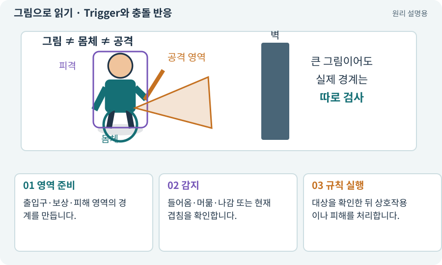

# Trigger와 충돌 반응

**분야:** 오브젝트·좌표·움직임

Trigger는 겹침을 감지하되 일반적인 물리 밀어내기를 하지 않는 경계입니다. Overlap은 특정 공간과 겹친 대상을 묻는 조회 방식입니다.

**찾아오는 이름:** Trigger와 충돌 반응, Trigger, 트리거, Is Trigger, Overlap

## 익숙한 것에 비유하면

자동문 센서는 사람을 감지하지만 스스로 벽처럼 사람을 막지 않습니다.



개념도입니다. 실제 Unity 화면이나 검사 결과가 아닙니다. 그림의 순서·색은 역할을 구분하며 실제 설정값은 프로젝트에서 확인합니다.

## 이렇게 작동합니다

### 1. 영역 준비

출입구·보상·피해 영역의 경계를 만듭니다.

### 2. 감지

들어옴·머묾·나감 또는 현재 겹침을 확인합니다.

### 3. 규칙 실행

대상을 확인한 뒤 상호작용이나 피해를 처리합니다.

## 우리 RPG에서는 이렇게 만나요

포털 감지 범위를 밟으면 안내가 나오지만 바로 강제 전환할지는 별도 게임 규칙입니다. 감지가 두 번 발생해도 보상이 두 번 지급되지 않게 합니다.

## 이것과 혼동하지 마세요

Trigger를 켜면 벽처럼 막힐 것이라고 기대하면 안 됩니다. 콜백은 물리 설정과 몸체 조합에도 영향을 받습니다.

## 이해했는지 한 번 생각해 보기

보상 영역이 반복 감지될 때 아이템이 복제되지 않으려면?

<details><summary>답과 이유</summary>

한 번 지급한 사건을 식별하고 중복 처리를 막는 규칙이 필요합니다.

</details>

## 내 프로젝트에서 확인하고 싶다면

아래 요청은 읽기 전용으로 실제 대상을 확인하는 선택 요청입니다. 코드나 설정을 직접 편집할 필요는 없습니다.

```text
현재 프로젝트에서 Trigger와 충돌 반응 관련 요소가 어떻게 사용되는지 읽기 전용으로 확인해 줘. 실제 대상과 설정을 찾아 쉬운 말과 작은 예로 설명해 줘. 특히 다음 혼동을 구분해 줘: Trigger를 켜면 벽처럼 막힐 것이라고 기대하면 안 됩니다. 콜백은 물리 설정과 몸체 조합에도 영향을 받습니다. 아직 코드·설정·파일은 바꾸지 말고, 확인할 수 없는 내용은 따로 알려 줘.
```

## 이어지는 개념

[Collider와 몸체 경계](collider.md) · [공격 ID·사건 ID·중복 피해 방지](event-id.md) · [멱등성·재시도해도 한 번](idempotency.md) · [상호작용·NPC·퀘스트](interaction.md)

## 이 개념을 사용하는 실습

[08 · WASD로 벽에 부딪히며 이동하기](../index.html#lesson-008) · [29 · 방마다 적과 상자 배치하기](../index.html#lesson-029) · [45 · 무작위 방과 통로 만들기](../index.html#lesson-045) · [49 · 여러 근접 적의 공격 나누기](../index.html#lesson-049) · [89 · 같은 전투 규칙을 3D에 연결하기](../index.html#lesson-089)

## 참고와 설명의 범위

기본 도구 동작은 아래 공식 자료를 참고했습니다. 비유·그림·RPG의 예시 수치와 정책은 이해를 위한 자체 예제입니다. 실제 API·지원 기능은 설치 버전과 계정에서 확인합니다.

- [Unity · Rigidbody2D](https://docs.unity3d.com/6000.3/Documentation/Manual/2d-physics/rigidbody/introduction-to-rigidbody-2d.html)

그림·계산 예제·조작 모형은 자체 제작한 설명입니다. 실제 Unity 화면, 서비스 생성 결과, 성능 실측 또는 게임 테스트 결과가 아닙니다. 자료 확인: 2026년 9월 26일.
