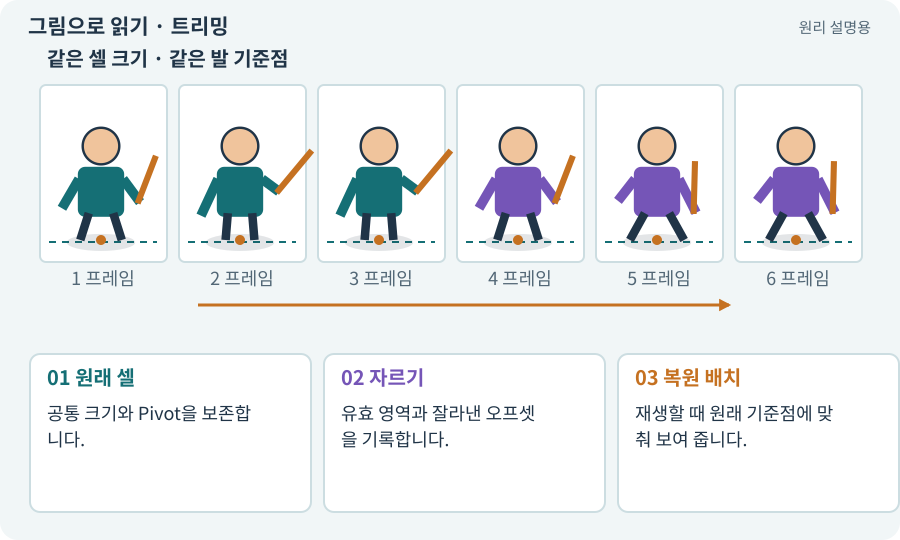

# 트리밍·오프셋·고정 셀

**분야:** 그림·애니메이션·화면 만들기

트리밍은 투명한 여백을 잘라 그림의 유효 영역만 남기는 과정입니다. 원래 셀에서의 위치를 잃으면 프레임별 발 위치와 배치가 흔들릴 수 있습니다.

**찾아오는 이름:** 트리밍·오프셋·고정 셀, 트리밍, trim, trimming, 오프셋, offset, 고정 셀

## 익숙한 것에 비유하면

사진 여백을 잘라도 원래 앨범에서 어느 위치에 붙였는지 메모를 남기는 것과 같습니다.



개념도입니다. 실제 Unity 화면이나 검사 결과가 아닙니다. 그림의 순서·색은 역할을 구분하며 실제 설정값은 프로젝트에서 확인합니다.

## 이렇게 작동합니다

### 1. 원래 셀

공통 크기와 Pivot을 보존합니다.

### 2. 자르기

유효 영역과 잘라낸 오프셋을 기록합니다.

### 3. 복원 배치

재생할 때 원래 기준점에 맞춰 보여 줍니다.

## 우리 RPG에서는 이렇게 만나요

공격 프레임은 넓고 대기 프레임은 좁아도 발은 같은 위치여야 합니다. 초반에는 고정 셀을 유지하는 편이 비교와 오류 발견에 쉽습니다.

## 이것과 혼동하지 마세요

용량을 줄인다는 이유로 모든 프레임을 중앙 정렬해 버리면 움직임이 흔들릴 수 있습니다.

## 이해했는지 한 번 생각해 보기

잘라낸 그림의 크기만 저장하면 충분한가요?

<details><summary>답과 이유</summary>

원래 셀·오프셋·Pivot 정보도 필요할 수 있습니다.

</details>

## 내 프로젝트에서 확인하고 싶다면

아래 요청은 읽기 전용으로 실제 대상을 확인하는 선택 요청입니다. 코드나 설정을 직접 편집할 필요는 없습니다.

```text
현재 프로젝트에서 트리밍·오프셋·고정 셀 관련 요소가 어떻게 사용되는지 읽기 전용으로 확인해 줘. 실제 대상과 설정을 찾아 쉬운 말과 작은 예로 설명해 줘. 특히 다음 혼동을 구분해 줘: 용량을 줄인다는 이유로 모든 프레임을 중앙 정렬해 버리면 움직임이 흔들릴 수 있습니다. 아직 코드·설정·파일은 바꾸지 말고, 확인할 수 없는 내용은 따로 알려 줘.
```

## 이어지는 개념

[Pivot과 발 기준점](pivot.md) · [슬라이싱·프레임 분리](slicing.md) · [Sprite Atlas와 패킹](atlas.md) · [패딩·여백·필터링 번짐](padding.md)

## 이 개념을 사용하는 실습

[61 · Ludo.ai로 키 포즈를 지정해 움직임 만들기](../index.html#lesson-061) · [62 · OpenAI 이미지로 게임 자산 만들기](../index.html#lesson-062) · [67 · 내 게임의 아트 제작 경로 선택하기](../index.html#lesson-067)

## 참고와 설명의 범위

기본 도구 동작은 아래 공식 자료를 참고했습니다. 비유·그림·RPG의 예시 수치와 정책은 이해를 위한 자체 예제입니다. 실제 API·지원 기능은 설치 버전과 계정에서 확인합니다.

- [Unity · Sprite](https://docs.unity3d.com/6000.3/Documentation/Manual/sprite/sprite-landing.html)

그림·계산 예제·조작 모형은 자체 제작한 설명입니다. 실제 Unity 화면, 서비스 생성 결과, 성능 실측 또는 게임 테스트 결과가 아닙니다. 자료 확인: 2026년 9월 26일.
