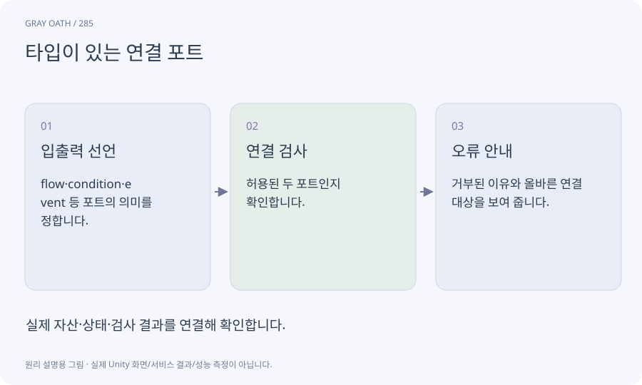

# 타입이 있는 연결 포트

노드의 입출력이 어떤 종류의 정보를 주고받는지 정한 접점입니다. 흐름과 숫자·참/거짓 값을 잘못 연결하지 않게 검사합니다.

## 익숙한 비유

충전선과 오디오 케이블을 구분하는 단자 모양입니다.



## 작동 원리

### 1. 입출력 선언

flow·condition·event 등 포트의 의미를 정합니다.

### 2. 연결 검사

허용된 두 포트인지 확인합니다.

### 3. 오류 안내

거부된 이유와 올바른 연결 대상을 보여 줍니다.

## 게임 속 예

조건 노드는 true/false 두 흐름을 내보내고 목표 노드는 completed/failed 흐름을 내보냅니다. 존재하지 않는 포트로 AI가 만든 선은 거부합니다.

## 혼동하지 않기

화면의 선 색상만 다르게 해서는 잘못된 연결을 막을 수 없습니다.

## 확인 질문

AI가 글자로 포트 이름을 만들어도 되나요?

등록된 포트와 스키마에 있는 이름만 허용하고 나머지는 오류로 처리합니다.

## 내 프로젝트에서 확인하기

```text
현재 GrayOathRPG3D에서 타입이 있는 연결 포트을 사용하는 실제 대상과 동작을 읽기 전용으로 확인해 줘. 쉬운 말과 작은 사례로 설명하고 화면의 선 색상만 다르게 해서는 잘못된 연결을 막을 수 없습니다. 이 문제를 어떻게 막는지 보여 줘. 코드·데이터·설정은 아직 수정하지 마.
```

## 관련 해설

[quest-graph](quest-graph.md) · [schema](schema.md) · [predicate-dsl](predicate-dsl.md)

## 공식 참고

- [Unity · UI Toolkit EditorWindow](https://docs.unity3d.com/6000.3/Documentation/Manual/UIE-HowTo-CreateEditorWindow.html)
