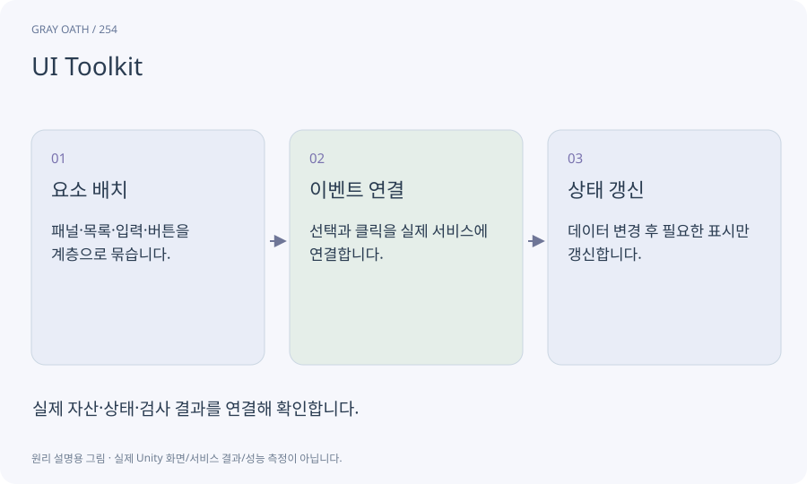

# UI Toolkit

Unity에서 화면 요소의 계층·스타일·이벤트를 이용해 UI를 구성하는 체계입니다. 이 과정에서는 Editor의 목록·상세 패널·노드 보기를 만드는 데 사용합니다.

## 익숙한 비유

화면을 이루는 레고 부품과 배치 규칙입니다. 목록과 버튼을 같은 스타일로 조립합니다.



## 작동 원리

### 1. 요소 배치

패널·목록·입력·버튼을 계층으로 묶습니다.

### 2. 이벤트 연결

선택과 클릭을 실제 서비스에 연결합니다.

### 3. 상태 갱신

데이터 변경 후 필요한 표시만 갱신합니다.

## 게임 속 예

왼쪽 퀘스트 목록에서 H01을 선택하면 오른쪽 목표·보상과 하단 오류가 함께 바뀝니다. 창 크기를 바꿔도 영역을 사용할 수 있어야 합니다.

## 혼동하지 않기

그래프처럼 보이는 UI를 만들었다고 연결 규칙이나 실행기가 자동으로 생기지는 않습니다.

## 확인 질문

이 기술을 쓰면 학생이 스타일 코드를 입력하나요?

코드와 배치는 AI가 만듭니다. 학생은 실제 창을 사용하며 원하는 동작과 잘못된 표시를 말합니다.

## 내 프로젝트에서 확인하기

```text
현재 GrayOathRPG3D에서 UI Toolkit을 사용하는 실제 대상과 동작을 읽기 전용으로 확인해 줘. 쉬운 말과 작은 사례로 설명하고 그래프처럼 보이는 UI를 만들었다고 연결 규칙이나 실행기가 자동으로 생기지는 않습니다. 이 문제를 어떻게 막는지 보여 줘. 코드·데이터·설정은 아직 수정하지 마.
```

## 관련 해설

[editor-window](editor-window.md) · [quest-graph](quest-graph.md) · [virtualization](virtualization.md)

## 공식 참고

- [Unity · UI Toolkit EditorWindow](https://docs.unity3d.com/6000.3/Documentation/Manual/UIE-HowTo-CreateEditorWindow.html)
