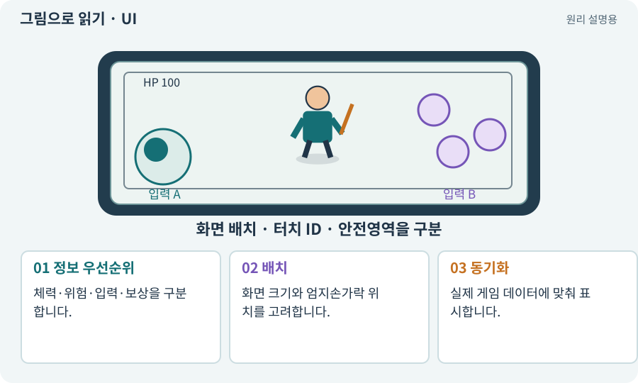

# UI·HUD·UGUI

**분야:** 입력·UI·소리·성능

UI는 메뉴·버튼·가방 등 사용자가 정보를 보고 조작하는 화면입니다. HUD는 플레이 중 체력·마나·스킬 상태처럼 지속 표시되는 정보를 뜻합니다. UGUI는 Unity의 UI 시스템 중 하나입니다.

**찾아오는 이름:** UI·HUD·UGUI, UI, HUD, UGUI, uGUI, 사용자 인터페이스, 헤드업 디스플레이

## 익숙한 것에 비유하면

자동차 계기판과 조작 패널입니다. 정보가 많다고 좋지 않고 운전에 필요한 것이 잘 보여야 합니다.



개념도입니다. 실제 Unity 화면이나 검사 결과가 아닙니다. 그림의 순서·색은 역할을 구분하며 실제 설정값은 프로젝트에서 확인합니다.

## 이렇게 작동합니다

### 1. 정보 우선순위

체력·위험·입력·보상을 구분합니다.

### 2. 배치

화면 크기와 엄지손가락 위치를 고려합니다.

### 3. 동기화

실제 게임 데이터에 맞춰 표시합니다.

## 우리 RPG에서는 이렇게 만나요

체력바 숫자가 맞아도 보스 예고를 가리면 플레이가 어렵습니다. Android 가로 화면에서 실제 위험 구역이 얼마나 보이는지 확인합니다.

## 이것과 혼동하지 마세요

UI는 게임 데이터의 원본이 아닙니다. 화면의 숫자만 바꾸고 실제 체력을 수정했다고 하지 않습니다.

## 이해했는지 한 번 생각해 보기

체력바와 실제 체력이 다른 이유는?

<details><summary>답과 이유</summary>

데이터 변경 사건·참조·초기 표시 동기화가 누락됐을 수 있습니다.

</details>

## 내 프로젝트에서 확인하고 싶다면

아래 요청은 읽기 전용으로 실제 대상을 확인하는 선택 요청입니다. 코드나 설정을 직접 편집할 필요는 없습니다.

```text
현재 프로젝트에서 UI·HUD·UGUI 관련 요소가 어떻게 사용되는지 읽기 전용으로 확인해 줘. 실제 대상과 설정을 찾아 쉬운 말과 작은 예로 설명해 줘. 특히 다음 혼동을 구분해 줘: UI는 게임 데이터의 원본이 아닙니다. 화면의 숫자만 바꾸고 실제 체력을 수정했다고 하지 않습니다. 아직 코드·설정·파일은 바꾸지 말고, 확인할 수 없는 내용은 따로 알려 줘.
```

## 이어지는 개념

[Canvas·RectTransform·앵커](canvas.md) · [EventSystem·UI 입력·클릭 차단](event-system.md) · [참조·null·Missing Reference](reference.md) · [접근성·가독성·피드백](accessibility.md)

## 이 개념을 사용하는 실습

[01 · 빈 2D 프로젝트 만들기](../index.html#lesson-001) · [06 · 시작 메뉴와 테스트 공간 연결하기](../index.html#lesson-006) · [07 · 캐릭터와 벽이 있는 공간 만들기](../index.html#lesson-007) · [09 · 클릭한 곳까지 벽을 돌아가기](../index.html#lesson-009) · [10 · 모바일 조이스틱과 버튼 배치하기](../index.html#lesson-010) · [11 · PC와 휴대폰에서 처음 실행하기](../index.html#lesson-011) · [12 · 체력과 피해를 눈으로 확인하기](../index.html#lesson-012) · [16 · 물약을 쓰고 죽은 뒤 다시 시작하기](../index.html#lesson-016) · [17 · 적을 잡아 레벨 올리기](../index.html#lesson-017) · [19 · 누가 때렸는지 보이는 전투 만들기](../index.html#lesson-019) · [21 · 몬스터가 장비를 떨어뜨리게 하기](../index.html#lesson-021) · [24 · 보기 편한 인벤토리 화면 만들기](../index.html#lesson-024) · [26 · 새 게임·이어하기·마을 연결하기](../index.html#lesson-026) · [27 · 회복하고 물약을 사는 마을 만들기](../index.html#lesson-027) · [30 · 예고를 보고 피하는 보스 만들기](../index.html#lesson-030) · [32 · 길 안내와 처음 하는 사람의 동선 만들기](../index.html#lesson-032) · [34 · 걷기·공격·피격·사망 움직임 연결하기](../index.html#lesson-034) · [35 · 앞뒤 가림과 PC 조작 다듬기](../index.html#lesson-035) · [36 · 휴대폰에서 두 손가락으로 전투하기](../index.html#lesson-036) · [38 · 테스트 결과와 실제 플레이 구분하기](../index.html#lesson-038) · [41 · 선택할 수 있는9노드 스킬트리 만들기](../index.html#lesson-041) · [42 · 트리에서 투자하고 저장하기](../index.html#lesson-042) · [43 · 빌드를 바꾸며 전투 비교하기](../index.html#lesson-043) · [53 · 입력은 빠르게, 취소 규칙은 명확하게](../index.html#lesson-053) · [54 · 느낌을 근거로 밸런스 고치기](../index.html#lesson-054) · [71 · 카메라·소리·피해 숫자 맞추기](../index.html#lesson-071) · [76 · 연결이 끊겨도 게임 계속하기](../index.html#lesson-076) · [78 · 선택: Google Play 에셋 전달 사용하기](../index.html#lesson-078) · [86 · 3D에서도 클릭한 곳까지 돌아가기](../index.html#lesson-086) · [93 · 3D 마을과 퀘스트 연결하기](../index.html#lesson-093) · [96 · 3D 카메라 가림과 터치 조작 다듬기](../index.html#lesson-096) · [102 · 네 배포물을 구분해 만들기](../index.html#lesson-102) · [126 · 한 요청으로 필터 기능 끝내기](../index.html#lesson-126) · [132 · 필터를 실제 던전과 모바일에 연결하기](../index.html#lesson-132) · [135 · 벽을 통과하지 않는 회피 만들기](../index.html#lesson-135) · [138 · 장비를 분해해 재료 얻기](../index.html#lesson-138) · [140 · 개인 창고와 즐겨찾기 만들기](../index.html#lesson-140) · [142 · 배운 스킬의 변형 선택하기](../index.html#lesson-142) · [146 · 대장장이 구조 퀘스트 만들기](../index.html#lesson-146) · [150 · 소리가 없어도 읽히는 전투 만들기](../index.html#lesson-150) · [151 · 도감과 장비 비교로 새 기능 찾기](../index.html#lesson-151) · [152 · 이전 저장을 새 확장판으로 가져오기](../index.html#lesson-152) · [154 · 확장 기능을 켠 휴대폰 성능 고치기](../index.html#lesson-154) · [158 · 룬 교체 버그를 역할로 수정하기](../index.html#lesson-158)

## 참고와 설명의 범위

기본 도구 동작은 아래 공식 자료를 참고했습니다. 비유·그림·RPG의 예시 수치와 정책은 이해를 위한 자체 예제입니다. 실제 API·지원 기능은 설치 버전과 계정에서 확인합니다.

- [Unity Input System · UI 지원](https://docs.unity3d.com/Packages/com.unity.inputsystem@1.17/manual/UISupport.html)

그림·계산 예제·조작 모형은 자체 제작한 설명입니다. 실제 Unity 화면, 서비스 생성 결과, 성능 실측 또는 게임 테스트 결과가 아닙니다. 자료 확인: 2026년 9월 26일.
