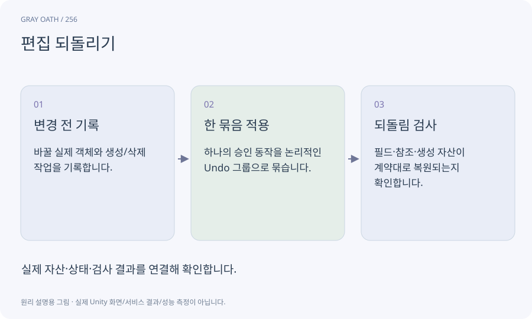

# 편집 되돌리기

Editor에서 승인한 변경을 되돌리거나 다시 적용하는 작업 기록입니다. 파일 백업·게임 세이브·Git과 목적이 다르며 모든 외부 작업을 되돌릴 수 있는 것은 아닙니다.

## 익숙한 비유

문서 편집의 되돌리기 버튼입니다. 이미 보낸 택배나 결제까지 취소해 주지는 않습니다.



## 작동 원리

### 1. 변경 전 기록

바꿀 실제 객체와 생성/삭제 작업을 기록합니다.

### 2. 한 묶음 적용

하나의 승인 동작을 논리적인 Undo 그룹으로 묶습니다.

### 3. 되돌림 검사

필드·참조·생성 자산이 계약대로 복원되는지 확인합니다.

## 게임 속 예

AI 초안의 노드 세 개를 승인했을 때 한 번의 Undo로 직전 상태를 복구합니다. 디스크 중간 실패는 별도 백업과 journal로 복구합니다.

## 혼동하지 않기

Undo는 유료 API 비용 환불이나 앱 플레이어 세이브 복구를 보장하지 않습니다.

## 확인 질문

AI 초안을 적용한 뒤 PC가 꺼져도 Undo면 충분한가요?

아닙니다. 복구 가능한 저장 사본과 적용 기록도 필요합니다.

## 내 프로젝트에서 확인하기

```text
현재 GrayOathRPG3D에서 편집 되돌리기을 사용하는 실제 대상과 동작을 읽기 전용으로 확인해 줘. 쉬운 말과 작은 사례로 설명하고 Undo는 유료 API 비용 환불이나 앱 플레이어 세이브 복구를 보장하지 않습니다. 이 문제를 어떻게 막는지 보여 줘. 코드·데이터·설정은 아직 수정하지 마.
```

## 관련 해설

[atomic-save](atomic-save.md) · [transaction](transaction.md) · [diff](diff.md)

## 공식 참고

- [Unity · Undo](https://docs.unity3d.com/6000.3/Documentation/ScriptReference/Undo.html)
