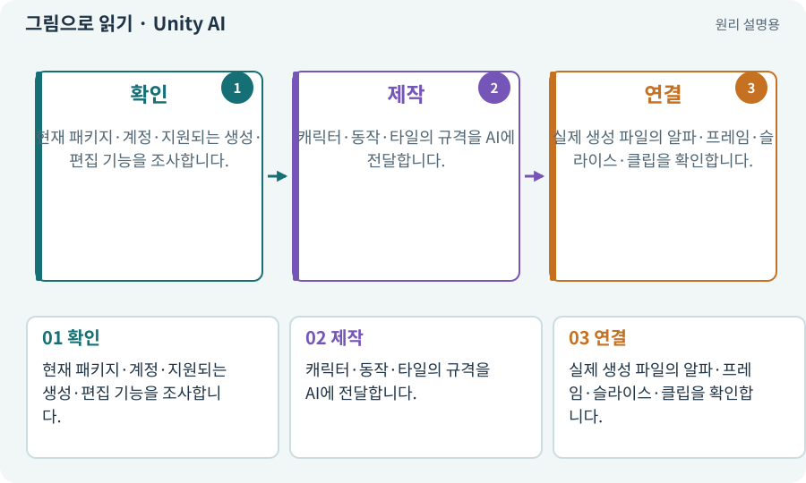

# Unity AI·스프라이트 제작 경로

**분야:** 자산 제작·렌더링 보충

Unity AI는 Editor와 연결되는 AI 제작 기능들의 묶음입니다. 사용하는 패키지·계정·지원 기능에 따라 실제 작업 경로가 달라집니다. AI Assistant와 스프라이트 생성 기능을 모두 같은 기능으로 가정하지 않습니다.

**찾아오는 이름:** Unity AI·스프라이트 제작 경로, Unity AI, UnityAI, Unity의 AI, Sprite Assistant

## 익숙한 것에 비유하면

작업실 안에 들어온 도우미와 도구 세트입니다. 도구함이 있다는 것과 모든 도구를 사용할 자격·설치가 갖춰진 것은 다릅니다.



개념도입니다. 실제 Unity 화면이나 검사 결과가 아닙니다. 그림의 순서·색은 역할을 구분하며 실제 설정값은 프로젝트에서 확인합니다.

## 이렇게 작동합니다

### 1. 확인

현재 패키지·계정·지원되는 생성·편집 기능을 조사합니다.

### 2. 제작

캐릭터·동작·타일의 규격을 AI에 전달합니다.

### 3. 연결

실제 생성 파일의 알파·프레임·슬라이스·클립을 확인합니다.

## 우리 RPG에서는 이렇게 만나요

Editor 안에서 스프라이트 시트를 만들더라도 공격 판정·발 위치·콜라이더는 별도 규칙으로 유지합니다. 생성 이미지를 봤다는 근거 없이 품질을 통과시키지 않습니다.

## 이것과 혼동하지 마세요

Unity AI가 연결됐다고 Claude Code의 로컬 도구와 Unity Pipeline 연결까지 자동 완성되는 것은 아닙니다.

## 이해했는지 한 번 생각해 보기

패키지는 설치됐지만 생성 버튼이 없으면?

<details><summary>답과 이유</summary>

버전·계정·기능 제공 조건과 실제 지원 경로를 확인하고 대안을 선택합니다.

</details>

## 내 프로젝트에서 확인하고 싶다면

아래 요청은 읽기 전용으로 실제 대상을 확인하는 선택 요청입니다. 코드나 설정을 직접 편집할 필요는 없습니다.

```text
현재 프로젝트에서 Unity AI·스프라이트 제작 경로 관련 요소가 어떻게 사용되는지 읽기 전용으로 확인해 줘. 실제 대상과 설정을 찾아 쉬운 말과 작은 예로 설명해 줘. 특히 다음 혼동을 구분해 줘: Unity AI가 연결됐다고 Claude Code의 로컬 도구와 Unity Pipeline 연결까지 자동 완성되는 것은 아닙니다. 아직 코드·설정·파일은 바꾸지 말고, 확인할 수 없는 내용은 따로 알려 줘.
```

## 이어지는 개념

[생성형 아트·참조 이미지·후처리](image-service.md) · [패키지·패키지 관리자](package.md) · [Unity Pipeline과 제작 파이프라인](pipeline.md) · [스프라이트 시트](sprite-sheet.md)

## 이 개념을 사용하는 실습

[56 · Unity AI로 캐릭터 움직임 만들기](../index.html#lesson-056) · [57 · Unity AI로 바닥과 벽 타일 만들기](../index.html#lesson-057) · [67 · 내 게임의 아트 제작 경로 선택하기](../index.html#lesson-067)

## 참고와 설명의 범위

기본 도구 동작은 아래 공식 자료를 참고했습니다. 비유·그림·RPG의 예시 수치와 정책은 이해를 위한 자체 예제입니다. 실제 API·지원 기능은 설치 버전과 계정에서 확인합니다.

- [Unity AI · 스프라이트 시트 생성과 연결](https://docs.unity3d.com/Packages/com.unity.ai.assistant@2.1/manual/Sprite/spritesheet-assistant.html)

그림·계산 예제·조작 모형은 자체 제작한 설명입니다. 실제 Unity 화면, 서비스 생성 결과, 성능 실측 또는 게임 테스트 결과가 아닙니다. 자료 확인: 2026년 9월 26일.
