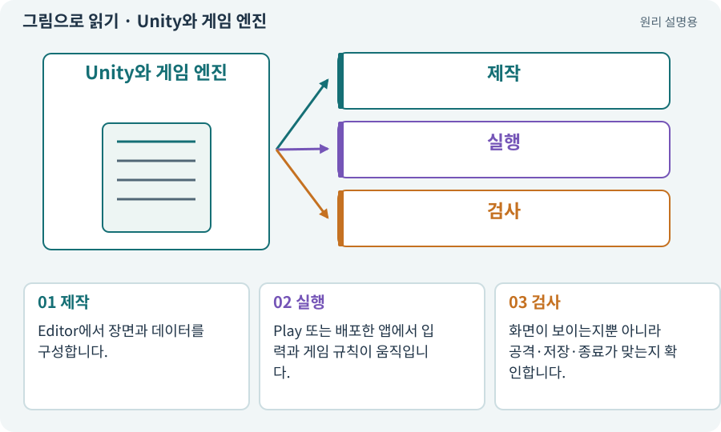

# Unity와 게임 엔진

**분야:** 시작·도구·작업 공간

게임 엔진은 그림을 표시하고 입력·충돌·소리·장면을 실행하는 공통 기능을 모은 제작 기반입니다. Unity는 그 엔진과 편집 환경을 제공합니다. 게임 규칙까지 알아서 완성하는 프로그램은 아닙니다.

**찾아오는 이름:** Unity와 게임 엔진, Unity, 게임 엔진, 유니티

## 익숙한 것에 비유하면

연극에 비유하면 무대·조명·음향 장비입니다. “적이 죽으면 어떤 보상을 주는가”라는 대본은 별도로 정해야 합니다.



개념도입니다. 실제 Unity 화면이나 검사 결과가 아닙니다. 그림의 순서·색은 역할을 구분하며 실제 설정값은 프로젝트에서 확인합니다.

## 이렇게 작동합니다

### 1. 제작

Editor에서 장면과 데이터를 구성합니다.

### 2. 실행

Play 또는 배포한 앱에서 입력과 게임 규칙이 움직입니다.

### 3. 검사

화면이 보이는지뿐 아니라 공격·저장·종료가 맞는지 확인합니다.

## 우리 RPG에서는 이렇게 만나요

우리 RPG의 타일을 그리는 기능은 엔진을 이용하지만, 희귀 검 드롭 확률과 24칸 가방 규칙은 프로젝트의 코드와 데이터입니다. AI는 둘을 연결하는 제작자 역할을 합니다.

## 이것과 혼동하지 마세요

AI가 C# 파일을 만들었다고 Unity 씬에 연결된 것은 아닙니다. 엔진 설치, 프로젝트 구성, 실제 실행은 따로 확인합니다.

## 이해했는지 한 번 생각해 보기

그림이 보이는 것만으로 장비 저장도 된 걸까요?

<details><summary>답과 이유</summary>

아닙니다. 그림은 렌더링 결과이며 저장은 별도의 데이터 처리입니다. 게임을 종료·재실행해 확인해야 합니다.

</details>

## 내 프로젝트에서 확인하고 싶다면

아래 요청은 읽기 전용으로 실제 대상을 확인하는 선택 요청입니다. 코드나 설정을 직접 편집할 필요는 없습니다.

```text
현재 프로젝트에서 Unity와 게임 엔진 관련 요소가 어떻게 사용되는지 읽기 전용으로 확인해 줘. 실제 대상과 설정을 찾아 쉬운 말과 작은 예로 설명해 줘. 특히 다음 혼동을 구분해 줘: AI가 C# 파일을 만들었다고 Unity 씬에 연결된 것은 아닙니다. 엔진 설치, 프로젝트 구성, 실제 실행은 따로 확인합니다. 아직 코드·설정·파일은 바꾸지 말고, 확인할 수 없는 내용은 따로 알려 줘.
```

## 이어지는 개념

[Unity Editor](editor.md) · [프로젝트와 프로젝트 루트](project.md) · [GameObject](gameobject.md) · [렌더링·Renderer](render.md) · [게임 빌드·개발 빌드·배포](build.md)

## 이 개념을 사용하는 실습

[01 · 빈 2D 프로젝트 만들기](../index.html#lesson-001) · [02 · 내 게임을 알아듣는 개발 스킬 만들기](../index.html#lesson-002) · [03 · AI와 실행 중인 Unity 연결하기](../index.html#lesson-003) · [04 · 되돌릴 수 있는 작업 습관 만들기](../index.html#lesson-004) · [05 · 말로 스프라이트 하나 만들기](../index.html#lesson-005) · [06 · 시작 메뉴와 테스트 공간 연결하기](../index.html#lesson-006) · [11 · PC와 휴대폰에서 처음 실행하기](../index.html#lesson-011) · [38 · 테스트 결과와 실제 플레이 구분하기](../index.html#lesson-038) · [39 · 다른 PC와 Android 에서 실행할 파일 만들기](../index.html#lesson-039) · [44 · 시드로 같은 던전 다시 만들기](../index.html#lesson-044) · [55 · 어떤 그림도 맞춰 넣는 아트 규격 정하기](../index.html#lesson-055) · [56 · Unity AI로 캐릭터 움직임 만들기](../index.html#lesson-056) · [57 · Unity AI로 바닥과 벽 타일 만들기](../index.html#lesson-057) · [59 · Retro Diffusion으로 캐릭터와 타일 만들기](../index.html#lesson-059) · [61 · Ludo.ai로 키 포즈를 지정해 움직임 만들기](../index.html#lesson-061) · [62 · OpenAI 이미지로 게임 자산 만들기](../index.html#lesson-062) · [63 · Grok 이미지로 같은 자산 시험하기](../index.html#lesson-063) · [64 · 추가 결제 없이 AI로 2D 프레임 만들기](../index.html#lesson-064) · [65 · 스프라이트를 정리해 실제 캐릭터에 넣기](../index.html#lesson-065) · [66 · 타일 경계와 랜덤맵 외형 연결하기](../index.html#lesson-066) · [68 · 피격 불꽃과 먼지 만들기](../index.html#lesson-068) · [69 · 베기와 폭발을 시트 애니메이션으로 만들기](../index.html#lesson-069) · [74 · 추가 외형을 서버에서 받게 준비하기](../index.html#lesson-074) · [78 · 선택: Google Play 에셋 전달 사용하기](../index.html#lesson-078) · [82 · 게임 규칙은 재사용하고 공간만 바꾸기](../index.html#lesson-082) · [97 · 선택: 3D 모델에서 2D 시트 만들기](../index.html#lesson-097) · [107 · 원본을 보호하고 허용 경로 정하기](../index.html#lesson-107) · [110 · 작업마다 필요한 자료만 준비하기](../index.html#lesson-110) · [112 · 네 역할을 순서대로 실행하기](../index.html#lesson-112) · [115 · 지금 코드의 검사만 인정하기](../index.html#lesson-115) · [117 · Unity 작업을 한 창구로 모으기](../index.html#lesson-117) · [124 · 현재 컴퓨터의 Unity 명령 등록하기](../index.html#lesson-124) · [125 · 하네스로 작은 전리품 화면 만들기](../index.html#lesson-125) · [126 · 한 요청으로 필터 기능 끝내기](../index.html#lesson-126) · [129 · 기존 2D 게임에서 확장팩 시작하기](../index.html#lesson-129) · [130 · 첫 확장 작업을 하네스에 연결하기](../index.html#lesson-130) · [131 · 중요한 전리품만 표시하는 규칙 만들기](../index.html#lesson-131) · [132 · 필터를 실제 던전과 모바일에 연결하기](../index.html#lesson-132) · [133 · 첫 기능의 실패를 고쳐 다음 기준 만들기](../index.html#lesson-133) · [134 · 화상·냉기·표식으로 전투 확장하기](../index.html#lesson-134) · [135 · 벽을 통과하지 않는 회피 만들기](../index.html#lesson-135) · [136 · 방패병과 화염술사 정예 추가하기](../index.html#lesson-136) · [137 · 기름·폭발통·밸브로 공간 활용하기](../index.html#lesson-137) · [138 · 장비를 분해해 재료 얻기](../index.html#lesson-138) · [139 · 재료로 장비 제작하기](../index.html#lesson-139) · [140 · 개인 창고와 즐겨찾기 만들기](../index.html#lesson-140) · [141 · 소켓 한 칸에 룬 장착하기](../index.html#lesson-141) · [142 · 배운 스킬의 변형 선택하기](../index.html#lesson-142) · [143 · 새 랜덤 지역 봉인된 대장간 만들기](../index.html#lesson-143) · [144 · 이번 탐험에만 남는 유물 고르기](../index.html#lesson-144) · [145 · 지원 동료 하나 만들기](../index.html#lesson-145) · [146 · 대장장이 구조 퀘스트 만들기](../index.html#lesson-146) · [147 · 용광로 감시자와 3단계 전투 만들기](../index.html#lesson-147) · [148 · 아트 역할로 새 지역 외형 완성하기](../index.html#lesson-148) · [149 · 상태와 보스 효과를 같은 데이터로 맞추기](../index.html#lesson-149) · [150 · 소리가 없어도 읽히는 전투 만들기](../index.html#lesson-150) · [151 · 도감과 장비 비교로 새 기능 찾기](../index.html#lesson-151) · [152 · 이전 저장을 새 확장판으로 가져오기](../index.html#lesson-152) · [153 · 대장간 고해상도팩 선택 다운로드하기](../index.html#lesson-153) · [154 · 확장 기능을 켠 휴대폰 성능 고치기](../index.html#lesson-154) · [155 · 기록을 보고 제작 경제와 전투 조정하기](../index.html#lesson-155) · [156 · 기능 조합에서 숨은 오류 찾기](../index.html#lesson-156) · [157 · 하네스가 실패해도 기록 지키기](../index.html#lesson-157) · [158 · 룬 교체 버그를 역할로 수정하기](../index.html#lesson-158) · [159 · 최종 확장판 배포 후보 만들기](../index.html#lesson-159) · [160 · 대장간 보스까지 완주하고 새 기능 맡기기](../index.html#lesson-160)

## 참고와 설명의 범위

기본 도구 동작은 아래 공식 자료를 참고했습니다. 비유·그림·RPG의 예시 수치와 정책은 이해를 위한 자체 예제입니다. 실제 API·지원 기능은 설치 버전과 계정에서 확인합니다.

- [Unity · 2D 게임 제작 흐름](https://docs.unity3d.com/6000.3/Documentation/Manual/2d-game-creation-wokflow.html)

그림·계산 예제·조작 모형은 자체 제작한 설명입니다. 실제 Unity 화면, 서비스 생성 결과, 성능 실측 또는 게임 테스트 결과가 아닙니다. 자료 확인: 2026년 9월 26일.
