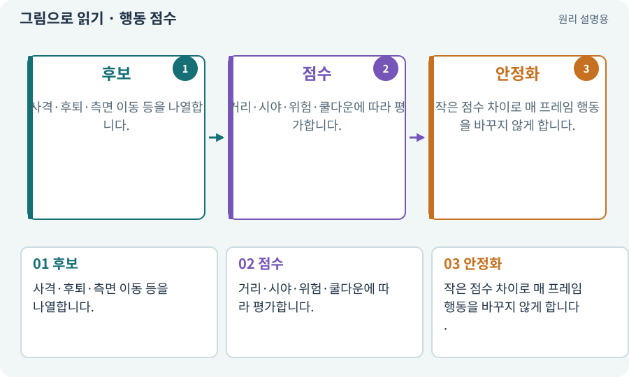

# 행동 점수·Utility AI

**분야:** 지도·적 AI·전투 규칙

가능한 행동에 현재 상황의 점수를 매겨 선택하는 AI 방식입니다. 점수가 높은 행동을 고르되 급격히 행동이 흔들리지 않도록 조건과 최소 유지 시간을 둡니다.

**찾아오는 이름:** 행동 점수·Utility AI, 행동 점수, Utility AI, 점수 기반 AI, 거리 유지, 측면 이동

## 익숙한 것에 비유하면

비가 오면 실내 길 점수가 높고 길이 막히면 우회 점수가 높아지는 의사결정표입니다.



개념도입니다. 실제 Unity 화면이나 검사 결과가 아닙니다. 그림의 순서·색은 역할을 구분하며 실제 설정값은 프로젝트에서 확인합니다.

## 이렇게 작동합니다

### 1. 후보

사격·후퇴·측면 이동 등을 나열합니다.

### 2. 점수

거리·시야·위험·쿨다운에 따라 평가합니다.

### 3. 안정화

작은 점수 차이로 매 프레임 행동을 바꾸지 않게 합니다.

## 우리 RPG에서는 이렇게 만나요

석궁수가 너무 가까우면 후퇴를, 벽에 가리면 측면 이동을 선택합니다. 선택한 위치까지 갈 수 있는지는 경로 서비스가 따로 확인합니다.

## 이것과 혼동하지 마세요

똑똑해 보이는 AI와 공정한 AI는 다릅니다. 즉각적인 완벽 회피가 항상 재미있지는 않습니다.

## 이해했는지 한 번 생각해 보기

석궁수가 앞뒤로 계속 떨리며 이동하는 이유는?

<details><summary>답과 이유</summary>

거리 경계에서 점수 순위가 계속 바뀔 수 있습니다. 유지 시간·히스테리시스를 확인합니다.

</details>

## 내 프로젝트에서 확인하고 싶다면

아래 요청은 읽기 전용으로 실제 대상을 확인하는 선택 요청입니다. 코드나 설정을 직접 편집할 필요는 없습니다.

```text
현재 프로젝트에서 행동 점수·Utility AI 관련 요소가 어떻게 사용되는지 읽기 전용으로 확인해 줘. 실제 대상과 설정을 찾아 쉬운 말과 작은 예로 설명해 줘. 특히 다음 혼동을 구분해 줘: 똑똑해 보이는 AI와 공정한 AI는 다릅니다. 즉각적인 완벽 회피가 항상 재미있지는 않습니다. 아직 코드·설정·파일은 바꾸지 말고, 확인할 수 없는 내용은 따로 알려 줘.
```

## 이어지는 개념

[상태 기계·FSM](state-machine.md) · [경로와 경유점](navigation.md) · [쿨다운·마나·자원 소비](cooldown.md) · [조우·전투 감독·페이즈](encounter.md)

## 이 개념을 사용하는 실습

[52 · 전투에서 선택할 이유 만들기](../index.html#lesson-052) · [90 · 적의 판단을 3D 공간에 연결하기](../index.html#lesson-090)

## 참고와 설명의 범위

이 항목의 비유·그림·RPG 수치·운영 규칙은 개념을 이해하기 위한 자체 설계 예제입니다. 특정 도구가 이 규칙을 자동으로 구현한다는 뜻은 아닙니다.


그림·계산 예제·조작 모형은 자체 제작한 설명입니다. 실제 Unity 화면, 서비스 생성 결과, 성능 실측 또는 게임 테스트 결과가 아닙니다. 자료 확인: 2026년 9월 26일.
