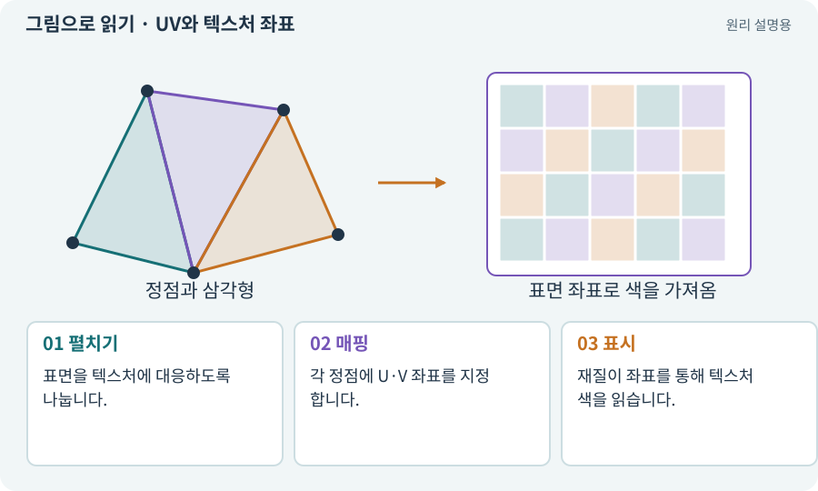

# UV와 텍스처 좌표

**분야:** 그림·애니메이션·화면 만들기

UV는 3D 표면의 어느 지점이 텍스처의 어느 부분을 사용할지 정하는 좌표입니다. 월드 X·Y·Z와 구분하기 위해 U·V라는 이름을 씁니다.

**찾아오는 이름:** UV와 텍스처 좌표, UV, UV 좌표, UV 맵, 언랩, unwrap

## 익숙한 것에 비유하면

지구본 껍질을 펼쳐 지도에 색칠한 뒤 다시 붙이는 방식입니다.



개념도입니다. 실제 Unity 화면이나 검사 결과가 아닙니다. 그림의 순서·색은 역할을 구분하며 실제 설정값은 프로젝트에서 확인합니다.

## 이렇게 작동합니다

### 1. 펼치기

표면을 텍스처에 대응하도록 나눕니다.

### 2. 매핑

각 정점에 U·V 좌표를 지정합니다.

### 3. 표시

재질이 좌표를 통해 텍스처 색을 읽습니다.

## 우리 RPG에서는 이렇게 만나요

벽을 길게 늘렸더니 돌무늬가 길게 늘어나면 UV·타일 반복 설정을 봅니다. 모델 크기 변화와 텍스처 반복을 별도로 맞출 수 있습니다.

## 이것과 혼동하지 마세요

UV는 2D 게임의 논리 바닥 좌표 (u,v)와 이름만 같을 수 있습니다. 문맥을 구분합니다.

## 이해했는지 한 번 생각해 보기

무늬만 늘어지고 충돌은 정상이라면?

<details><summary>답과 이유</summary>

메시 UV·재질의 반복 크기를 확인합니다.

</details>

## 내 프로젝트에서 확인하고 싶다면

아래 요청은 읽기 전용으로 실제 대상을 확인하는 선택 요청입니다. 코드나 설정을 직접 편집할 필요는 없습니다.

```text
현재 프로젝트에서 UV와 텍스처 좌표 관련 요소가 어떻게 사용되는지 읽기 전용으로 확인해 줘. 실제 대상과 설정을 찾아 쉬운 말과 작은 예로 설명해 줘. 특히 다음 혼동을 구분해 줘: UV는 2D 게임의 논리 바닥 좌표 (u,v)와 이름만 같을 수 있습니다. 문맥을 구분합니다. 아직 코드·설정·파일은 바꾸지 말고, 확인할 수 없는 내용은 따로 알려 줘.
```

## 이어지는 개념

[메시·정점·삼각형·노멀](mesh.md) · [텍스처·픽셀·해상도](texture.md) · [Material과 Shader](material.md) · [심리스·타일 반복·스타일 일관성](seamless.md)

## 이 개념을 사용하는 실습

[65 · 스프라이트를 정리해 실제 캐릭터에 넣기](../index.html#lesson-065) · [69 · 베기와 폭발을 시트 애니메이션으로 만들기](../index.html#lesson-069)

## 참고와 설명의 범위

기본 도구 동작은 아래 공식 자료를 참고했습니다. 비유·그림·RPG의 예시 수치와 정책은 이해를 위한 자체 예제입니다. 실제 API·지원 기능은 설치 버전과 계정에서 확인합니다.

- [Unity · Sprite](https://docs.unity3d.com/6000.3/Documentation/Manual/sprite/sprite-landing.html)

그림·계산 예제·조작 모형은 자체 제작한 설명입니다. 실제 Unity 화면, 서비스 생성 결과, 성능 실측 또는 게임 테스트 결과가 아닙니다. 자료 확인: 2026년 9월 26일.
