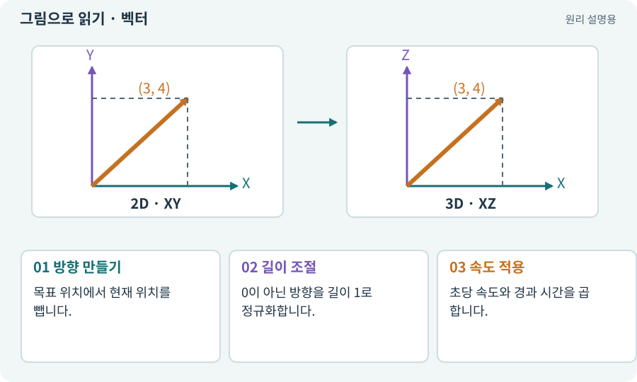

# 벡터·방향·정규화

**분야:** 오브젝트·좌표·움직임

벡터는 방향과 크기를 함께 나타내는 값입니다. 위치 두 개의 차이는 목표로 향하는 벡터이며, 정규화는 방향을 유지하면서 길이를 1로 만드는 과정입니다.

**찾아오는 이름:** 벡터·방향·정규화, 벡터, Vector2, Vector3, 정규화, normalized, normalize, Facing, forward

## 익숙한 것에 비유하면

화살표의 방향은 어디로, 길이는 얼마나를 뜻합니다. 이동 속도를 따로 곱하려면 방향 화살표 길이를 일정하게 맞춥니다.



개념도입니다. 실제 Unity 화면이나 검사 결과가 아닙니다. 그림의 순서·색은 역할을 구분하며 실제 설정값은 프로젝트에서 확인합니다.

## 이렇게 작동합니다

### 1. 방향 만들기

목표 위치에서 현재 위치를 뺍니다.

### 2. 길이 조절

0이 아닌 방향을 길이 1로 정규화합니다.

### 3. 속도 적용

초당 속도와 경과 시간을 곱합니다.

## 우리 RPG에서는 이렇게 만나요

오른쪽+위 입력 (1,1)의 길이는 약 1.414입니다. 이를 그대로 쓰면 대각선이 더 빠릅니다. 입력 길이를 1 이하로 제한하되 조이스틱의 약한 입력 크기는 보존합니다.

## 이것과 혼동하지 마세요

0 벡터는 방향이 없습니다. 멈췄을 때 마지막 바라보는 방향을 별도로 보존할 수 있습니다.

## 이해했는지 한 번 생각해 보기

대각선 이동이 더 빠르면 무엇을 의심하나요?

<details><summary>답과 이유</summary>

방향 길이를 제한하지 않았거나 입력 강도와 방향을 섞었을 수 있습니다.

</details>

## 내 프로젝트에서 확인하고 싶다면

아래 요청은 읽기 전용으로 실제 대상을 확인하는 선택 요청입니다. 코드나 설정을 직접 편집할 필요는 없습니다.

```text
현재 프로젝트에서 벡터·방향·정규화 관련 요소가 어떻게 사용되는지 읽기 전용으로 확인해 줘. 실제 대상과 설정을 찾아 쉬운 말과 작은 예로 설명해 줘. 특히 다음 혼동을 구분해 줘: 0 벡터는 방향이 없습니다. 멈췄을 때 마지막 바라보는 방향을 별도로 보존할 수 있습니다. 아직 코드·설정·파일은 바꾸지 말고, 확인할 수 없는 내용은 따로 알려 줘.
```

## 이어지는 개념

[deltaTime과 초당 속도](delta-time.md) · [이동 모터와 단일 위치 책임](motor.md) · [데드존·입력 강도](deadzone.md) · [XY·XZ 평면과 논리 좌표](coordinates.md)

## 이 개념을 사용하는 실습

[07 · 캐릭터와 벽이 있는 공간 만들기](../index.html#lesson-007) · [08 · WASD로 벽에 부딪히며 이동하기](../index.html#lesson-008) · [13 · 적을 클릭해 접근하고 공격하기](../index.html#lesson-013) · [14 · 나를 발견하고 공격하는 적 만들기](../index.html#lesson-014) · [34 · 걷기·공격·피격·사망 움직임 연결하기](../index.html#lesson-034) · [50 · 석궁수가 거리를 유지하게 만들기](../index.html#lesson-050) · [55 · 어떤 그림도 맞춰 넣는 아트 규격 정하기](../index.html#lesson-055) · [82 · 게임 규칙은 재사용하고 공간만 바꾸기](../index.html#lesson-082) · [85 · 3D 캐릭터를 한 모터로 움직이기](../index.html#lesson-085) · [88 · 3D 모델에 걷기와 공격 연결하기](../index.html#lesson-088) · [89 · 같은 전투 규칙을 3D에 연결하기](../index.html#lesson-089) · [96 · 3D 카메라 가림과 터치 조작 다듬기](../index.html#lesson-096) · [97 · 선택: 3D 모델에서 2D 시트 만들기](../index.html#lesson-097) · [106 · 도구가 상태를 기억하게 만들기](../index.html#lesson-106) · [107 · 원본을 보호하고 허용 경로 정하기](../index.html#lesson-107) · [135 · 벽을 통과하지 않는 회피 만들기](../index.html#lesson-135)

## 참고와 설명의 범위

기본 도구 동작은 아래 공식 자료를 참고했습니다. 비유·그림·RPG의 예시 수치와 정책은 이해를 위한 자체 예제입니다. 실제 API·지원 기능은 설치 버전과 계정에서 확인합니다.

- [Unity · Transform](https://docs.unity3d.com/6000.3/Documentation/Manual/class-Transform.html)

그림·계산 예제·조작 모형은 자체 제작한 설명입니다. 실제 Unity 화면, 서비스 생성 결과, 성능 실측 또는 게임 테스트 결과가 아닙니다. 자료 확인: 2026년 9월 26일.
