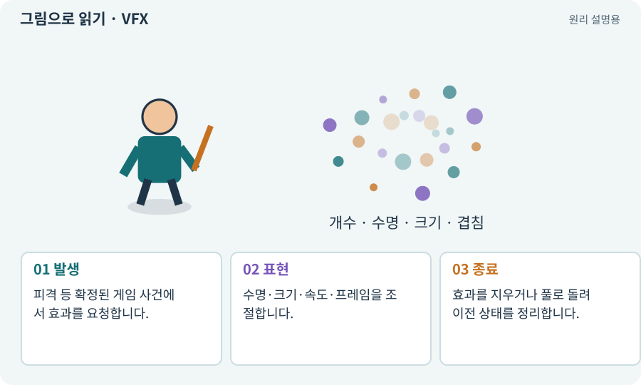

# VFX·Particle System·플립북

**분야:** 그림·애니메이션·화면 만들기

VFX는 불꽃·먼지·마법 같은 시각 효과입니다. Particle System은 작은 입자 여러 개를 생성·이동·소멸시키며, 플립북은 텍스처의 여러 프레임을 순서대로 보여 주는 방식입니다.

**찾아오는 이름:** VFX·Particle System·플립북, VFX, 이펙트, 파티클, Particle System, Particle, 플립북, Flipbook, Texture Sheet Animation

## 익숙한 것에 비유하면

불꽃 종이 조각을 여러 개 뿌리거나, 폭발 그림책을 빠르게 넘기는 두 방식입니다.



개념도입니다. 실제 Unity 화면이나 검사 결과가 아닙니다. 그림의 순서·색은 역할을 구분하며 실제 설정값은 프로젝트에서 확인합니다.

## 이렇게 작동합니다

### 1. 발생

피격 등 확정된 게임 사건에서 효과를 요청합니다.

### 2. 표현

수명·크기·속도·프레임을 조절합니다.

### 3. 종료

효과를 지우거나 풀로 돌려 이전 상태를 정리합니다.

## 우리 RPG에서는 이렇게 만나요

검 궤적은 짧은 시트 애니메이션, 먼지는 여러 입자로 표현할 수 있습니다. 바닥 위험 표시는 장식 입자와 분리해 낮은 품질에서도 유지합니다.

## 이것과 혼동하지 마세요

입자가 적 몸에 닿았다고 자동 피해로 사용하지 않습니다. 게임 판정과 표시를 분리합니다.

## 이해했는지 한 번 생각해 보기

파티클 수를 줄였는데 피해량도 줄면?

<details><summary>답과 이유</summary>

효과 입자 수가 피해 규칙과 잘못 결합됐는지 확인합니다.

</details>

## 내 프로젝트에서 확인하고 싶다면

아래 요청은 읽기 전용으로 실제 대상을 확인하는 선택 요청입니다. 코드나 설정을 직접 편집할 필요는 없습니다.

```text
현재 프로젝트에서 VFX·Particle System·플립북 관련 요소가 어떻게 사용되는지 읽기 전용으로 확인해 줘. 실제 대상과 설정을 찾아 쉬운 말과 작은 예로 설명해 줘. 특히 다음 혼동을 구분해 줘: 입자가 적 몸에 닿았다고 자동 피해로 사용하지 않습니다. 게임 판정과 표시를 분리합니다. 아직 코드·설정·파일은 바꾸지 말고, 확인할 수 없는 내용은 따로 알려 줘.
```

## 이어지는 개념

[오브젝트 풀링](pool.md) · [스프라이트 시트](sprite-sheet.md) · [Shader Graph·노드·마스크](shader-graph.md) · [오버드로·투명 효과 비용](overdraw.md)

## 이 개념을 사용하는 실습

[13 · 적을 클릭해 접근하고 공격하기](../index.html#lesson-013) · [18 · 베기·마력탄·회전 공격 만들기](../index.html#lesson-018) · [19 · 누가 때렸는지 보이는 전투 만들기](../index.html#lesson-019) · [37 · 느려지는 원인을 측정해 고치기](../index.html#lesson-037) · [51 · 전투 전체의 압박 조절하기](../index.html#lesson-051) · [52 · 전투에서 선택할 이유 만들기](../index.html#lesson-052) · [54 · 느낌을 근거로 밸런스 고치기](../index.html#lesson-054) · [68 · 피격 불꽃과 먼지 만들기](../index.html#lesson-068) · [69 · 베기와 폭발을 시트 애니메이션으로 만들기](../index.html#lesson-069) · [71 · 카메라·소리·피해 숫자 맞추기](../index.html#lesson-071) · [72 · 모바일 효과를 줄여도 위험은 남기기](../index.html#lesson-072) · [86 · 3D에서도 클릭한 곳까지 돌아가기](../index.html#lesson-086) · [89 · 같은 전투 규칙을 3D에 연결하기](../index.html#lesson-089) · [91 · 보스 예고를 3D 바닥에 맞추기](../index.html#lesson-091) · [137 · 기름·폭발통·밸브로 공간 활용하기](../index.html#lesson-137) · [142 · 배운 스킬의 변형 선택하기](../index.html#lesson-142) · [149 · 상태와 보스 효과를 같은 데이터로 맞추기](../index.html#lesson-149) · [154 · 확장 기능을 켠 휴대폰 성능 고치기](../index.html#lesson-154)

## 참고와 설명의 범위

기본 도구 동작은 아래 공식 자료를 참고했습니다. 비유·그림·RPG의 예시 수치와 정책은 이해를 위한 자체 예제입니다. 실제 API·지원 기능은 설치 버전과 계정에서 확인합니다.

- [Unity · Texture Sheet Animation](https://docs.unity3d.com/6000.3/Documentation/Manual/PartSysTexSheetAnimModule.html)

그림·계산 예제·조작 모형은 자체 제작한 설명입니다. 실제 Unity 화면, 서비스 생성 결과, 성능 실측 또는 게임 테스트 결과가 아닙니다. 자료 확인: 2026년 9월 26일.
