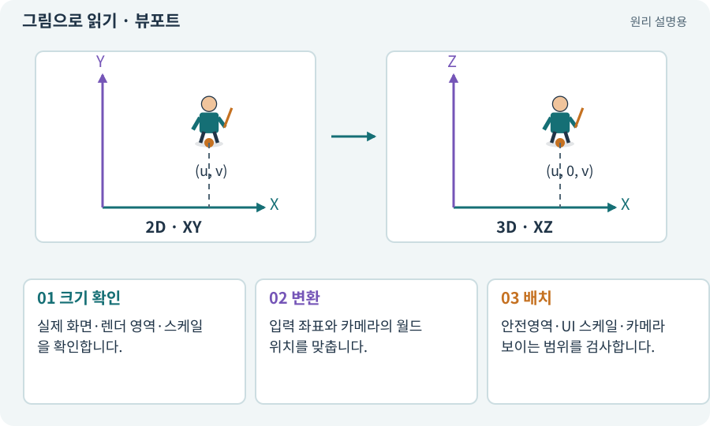

# 뷰포트·해상도·종횡비

**분야:** 자산 제작·렌더링 보충

뷰포트는 화면에서 카메라가 그리는 영역입니다. 해상도는 픽셀 개수, 종횡비는 가로와 세로의 비율입니다. 같은 세계를 그려도 보이는 범위·UI·선택 좌표에 영향을 줍니다.

**찾아오는 이름:** 뷰포트·해상도·종횡비, 뷰포트, Viewport, viewport, 해상도, 종횡비, Aspect Ratio, Screen Space, 렌더 타깃, bufferViewport, cssViewport

## 익숙한 것에 비유하면

같은 풍경을 가로 창문과 세로 창문으로 보는 것입니다. 유리의 크기와 창문 비율, 바라보는 위치를 구분합니다.



개념도입니다. 실제 Unity 화면이나 검사 결과가 아닙니다. 그림의 순서·색은 역할을 구분하며 실제 설정값은 프로젝트에서 확인합니다.

## 이렇게 작동합니다

### 1. 크기 확인

실제 화면·렌더 영역·스케일을 확인합니다.

### 2. 변환

입력 좌표와 카메라의 월드 위치를 맞춥니다.

### 3. 배치

안전영역·UI 스케일·카메라 보이는 범위를 검사합니다.

## 우리 RPG에서는 이렇게 만나요

Android에서 화면 픽셀과 축소 렌더 버퍼 크기가 다를 수 있습니다. 클릭 Ray나 조이스틱 좌표의 분모를 잘못 사용하면 버튼과 실제 반응 위치가 어긋납니다.

## 이것과 혼동하지 마세요

해상도를 낮추는 것과 카메라의 Orthographic Size를 줄이는 것은 다릅니다.

## 이해했는지 한 번 생각해 보기

픽셀 수가 두 배면 세계도 두 배로 보이나요?

<details><summary>답과 이유</summary>

같은 카메라 설정과 비율이라면 더 촘촘하게 그릴 뿐 세계 범위가 반드시 늘지는 않습니다.

</details>

## 내 프로젝트에서 확인하고 싶다면

아래 요청은 읽기 전용으로 실제 대상을 확인하는 선택 요청입니다. 코드나 설정을 직접 편집할 필요는 없습니다.

```text
현재 프로젝트에서 뷰포트·해상도·종횡비 관련 요소가 어떻게 사용되는지 읽기 전용으로 확인해 줘. 실제 대상과 설정을 찾아 쉬운 말과 작은 예로 설명해 줘. 특히 다음 혼동을 구분해 줘: 해상도를 낮추는 것과 카메라의 Orthographic Size를 줄이는 것은 다릅니다. 아직 코드·설정·파일은 바꾸지 말고, 확인할 수 없는 내용은 따로 알려 줘.
```

## 이어지는 개념

[카메라·직교·원근](camera.md) · [화면 좌표에서 월드 좌표로](screen-world.md) · [Canvas·RectTransform·앵커](canvas.md) · [안전영역·화면 비율·Viewport](safe-area.md)

## 이 개념을 사용하는 실습

[35 · 앞뒤 가림과 PC 조작 다듬기](../index.html#lesson-035) · [37 · 느려지는 원인을 측정해 고치기](../index.html#lesson-037) · [59 · Retro Diffusion으로 캐릭터와 타일 만들기](../index.html#lesson-059) · [67 · 내 게임의 아트 제작 경로 선택하기](../index.html#lesson-067) · [93 · 3D 마을과 퀘스트 연결하기](../index.html#lesson-093) · [95 · 3D 조명과 환경을 읽기 좋게 만들기](../index.html#lesson-095) · [153 · 대장간 고해상도팩 선택 다운로드하기](../index.html#lesson-153) · [154 · 확장 기능을 켠 휴대폰 성능 고치기](../index.html#lesson-154)

## 참고와 설명의 범위

기본 도구 동작은 아래 공식 자료를 참고했습니다. 비유·그림·RPG의 예시 수치와 정책은 이해를 위한 자체 예제입니다. 실제 API·지원 기능은 설치 버전과 계정에서 확인합니다.

- [Unity · 2D Renderer](https://docs.unity3d.com/6000.3/Documentation/Manual/urp/2DRendererData-overview.html)

그림·계산 예제·조작 모형은 자체 제작한 설명입니다. 실제 Unity 화면, 서비스 생성 결과, 성능 실측 또는 게임 테스트 결과가 아닙니다. 자료 확인: 2026년 9월 26일.
