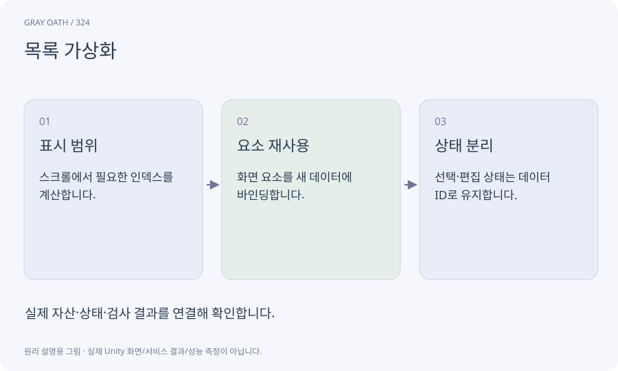

# 목록 가상화

목록 전체의 화면 요소를 만들지 않고 지금 보이는 항목과 소량의 여유분만 만들어 재사용하는 방식입니다. 데이터 전체를 없애는 것이 아닙니다.

## 익숙한 비유

창고의 모든 물건을 진열하지 않고 현재 보고 있는 페이지의 선반만 채우는 것입니다.



## 작동 원리

### 1. 표시 범위

스크롤에서 필요한 인덱스를 계산합니다.

### 2. 요소 재사용

화면 요소를 새 데이터에 바인딩합니다.

### 3. 상태 분리

선택·편집 상태는 데이터 ID로 유지합니다.

## 게임 속 예

퀘스트1000개 목록을 스크롤해도 표시 요소 수는 제한합니다. 재사용 항목에 이전 퀘스트의 버튼 이벤트가 남지 않게 합니다.

## 혼동하지 않기

행 번호를 영구 ID로 쓰면 검색·정렬 뒤 다른 데이터를 수정할 수 있습니다.

## 확인 질문

선택한 행이 스크롤 밖으로 나가면 선택을 잃나요?

선택을 안정된 데이터 ID로 보관하면 화면 요소가 재사용돼도 유지됩니다.

## 내 프로젝트에서 확인하기

```text
현재 GrayOathRPG3D에서 목록 가상화을 사용하는 실제 대상과 동작을 읽기 전용으로 확인해 줘. 쉬운 말과 작은 사례로 설명하고 행 번호를 영구 ID로 쓰면 검색·정렬 뒤 다른 데이터를 수정할 수 있습니다. 이 문제를 어떻게 막는지 보여 줘. 코드·데이터·설정은 아직 수정하지 마.
```

## 관련 해설

[ui-toolkit](ui-toolkit.md) · [identifier](identifier.md) · [lifecycle](lifecycle.md)

## 공식 참고

- [Unity · UI Toolkit EditorWindow](https://docs.unity3d.com/6000.3/Documentation/Manual/UIE-HowTo-CreateEditorWindow.html)
