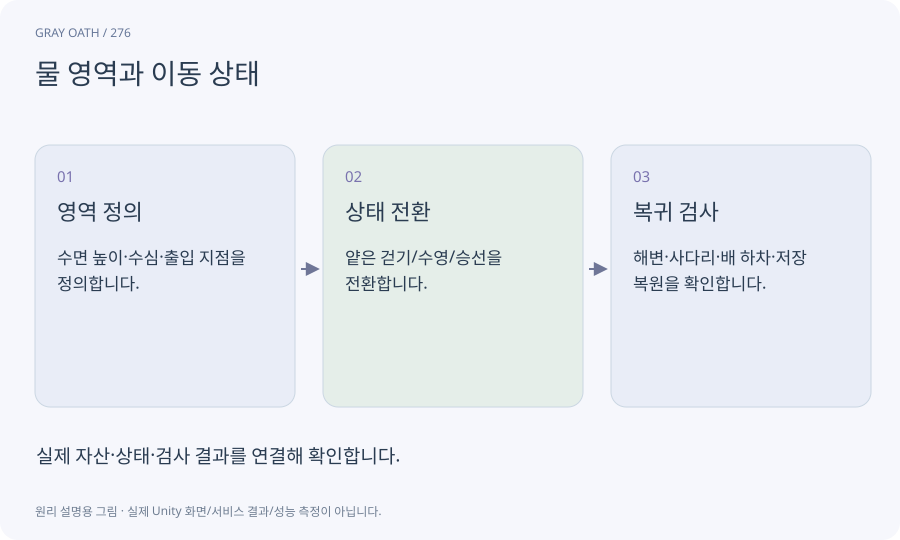

# 물 영역과 이동 상태

플레이어가 얕은 물·깊은 물·육지 중 어디에 있는지 판별하는 영역과 규칙입니다. 보이는 물 재질과 물리·게임 이동 규칙은 별개입니다.

## 익숙한 비유

수영장의 수심 표지와 물의 반짝이는 모습이 다른 정보인 것과 같습니다.



## 작동 원리

### 1. 영역 정의

수면 높이·수심·출입 지점을 정의합니다.

### 2. 상태 전환

얕은 걷기/수영/승선을 전환합니다.

### 3. 복귀 검사

해변·사다리·배 하차·저장 복원을 확인합니다.

## 게임 속 예

이 게임의 수영은 수면 이동으로 제한하고 잠수는 범위 밖입니다. 물이 보이지 않는 Low 품질에서도 이동 상태가 동일해야 합니다.

## 혼동하지 않기

물 셰이더를 만들었다고 자동으로 부력·수영·항해가 구현되는 것은 아닙니다.

## 확인 질문

육지로 나왔는데 수영 모션이 남으면?

영역 경계·지면 높이·상태 종료 이벤트와 애니메이션 해제를 확인합니다.

## 내 프로젝트에서 확인하기

```text
현재 GrayOathRPG3D에서 물 영역과 이동 상태을 사용하는 실제 대상과 동작을 읽기 전용으로 확인해 줘. 쉬운 말과 작은 사례로 설명하고 물 셰이더를 만들었다고 자동으로 부력·수영·항해가 구현되는 것은 아닙니다. 이 문제를 어떻게 막는지 보여 줘. 코드·데이터·설정은 아직 수정하지 마.
```

## 관련 해설

[state-machine](state-machine.md) · [trigger](trigger.md) · [motor](motor.md)

## 공식 참고

- [Unity · NavMeshLink](https://docs.unity3d.com/Packages/com.unity.ai.navigation@2.0/manual/NavMeshLink.html)
