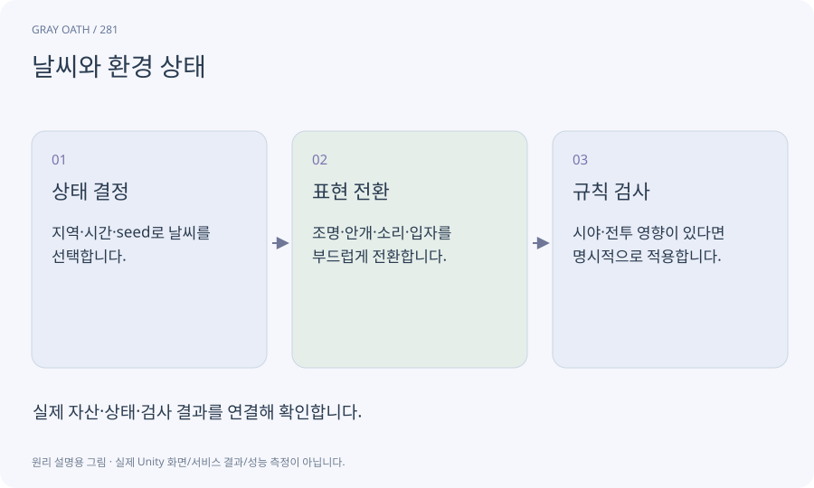

# 날씨와 환경 상태

맑음·비·안개 등의 세계 상태와 그 표현을 연결하는 체계입니다. 시각 효과와 게임 규칙 영향의 범위를 명확히 해야 합니다.

## 익숙한 비유

무대 분위기와 실제 공연 조건을 별도로 정하는 조명표입니다.



## 작동 원리

### 1. 상태 결정

지역·시간·seed로 날씨를 선택합니다.

### 2. 표현 전환

조명·안개·소리·입자를 부드럽게 전환합니다.

### 3. 규칙 검사

시야·전투 영향이 있다면 명시적으로 적용합니다.

## 게임 속 예

비 입자는 Android Low에서 줄이지만 비 상태와 관련 NPC 대사는 유지합니다. 세계 상태를 효과 재생 여부로 추정하지 않습니다.

## 혼동하지 않기

날씨 효과를 끄면 퀘스트 조건까지 달라지는 구조는 피합니다.

## 확인 질문

안개가 너무 짙어 공격 예고가 안 보이면?

품질/접근성 설정과 위험 표시 대비를 조절하고 실제 플레이로 다시 확인합니다.

## 내 프로젝트에서 확인하기

```text
현재 GrayOathRPG3D에서 날씨와 환경 상태을 사용하는 실제 대상과 동작을 읽기 전용으로 확인해 줘. 쉬운 말과 작은 사례로 설명하고 날씨 효과를 끄면 퀘스트 조건까지 달라지는 구조는 피합니다. 이 문제를 어떻게 막는지 보여 줘. 코드·데이터·설정은 아직 수정하지 마.
```

## 관련 해설

[world-clock](world-clock.md) · [vfx](vfx.md) · [world-state](world-state.md)

## 공식 참고

- [Unity · URP performance](https://docs.unity3d.com/6000.3/Documentation/Manual/urp/understand-performance.html)
