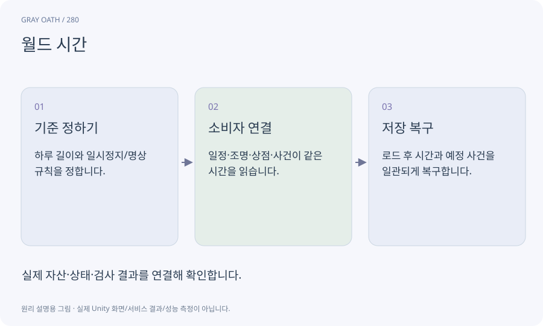

# 월드 시간

게임 세계의 하루가 얼마나 지났는지 나타내는 시간입니다. 현실 시각·프레임 deltaTime·전투 쿨다운과 목적이 다릅니다.

## 익숙한 비유

이야기 속 달력입니다. 실제 시계와 별도로 빠르게 흐르거나 멈출 수 있습니다.



## 작동 원리

### 1. 기준 정하기

하루 길이와 일시정지/명상 규칙을 정합니다.

### 2. 소비자 연결

일정·조명·상점·사건이 같은 시간을 읽습니다.

### 3. 저장 복구

로드 후 시간과 예정 사건을 일관되게 복구합니다.

## 게임 속 예

명상으로6시간 건너뛰면 필요한 일정 전환을 계산하되 매 프레임을6시간치 재생하지 않습니다.

## 혼동하지 않기

월드 시간을 빨리 감았다고 모든 상태이상·전투 쿨다운이 임의로 회복되면 편법이 생깁니다.

## 확인 질문

메뉴를 열면 마을 주민도 계속 움직여야 하나요?

게임이 정한 정지 정책을 따라야 하며 시간 소비자 모두가 같은 정책을 사용합니다.

## 내 프로젝트에서 확인하기

```text
현재 GrayOathRPG3D에서 월드 시간을 사용하는 실제 대상과 동작을 읽기 전용으로 확인해 줘. 쉬운 말과 작은 사례로 설명하고 월드 시간을 빨리 감았다고 모든 상태이상·전투 쿨다운이 임의로 회복되면 편법이 생깁니다. 이 문제를 어떻게 막는지 보여 줘. 코드·데이터·설정은 아직 수정하지 마.
```

## 관련 해설

[npc-schedule](npc-schedule.md) · [weather](weather.md) · [time-scale](time-scale.md)

## 공식 참고

- [Unity · Timeline](https://docs.unity3d.com/Packages/com.unity.timeline@1.8/manual/index.html)
