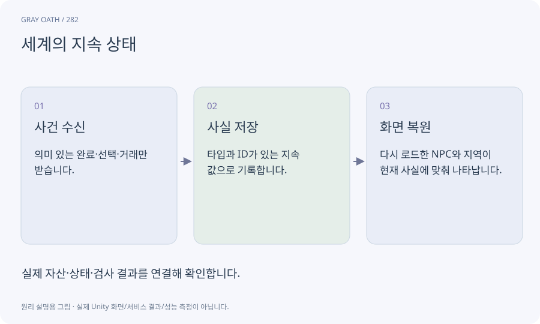

# 세계의 지속 상태

현재 로드된 오브젝트와 관계없이 남는 사건·선택·소유의 기록입니다. 누가 구출됐는지, 문이 열렸는지, 어떤 보상을 받았는지를 안정된 ID로 보관합니다.

## 익숙한 비유

무대 세트를 치워도 이야기의 앞 장면에서 일어난 사실이 남아 있는 대본 기록입니다.



## 작동 원리

### 1. 사건 수신

의미 있는 완료·선택·거래만 받습니다.

### 2. 사실 저장

타입과 ID가 있는 지속 값으로 기록합니다.

### 3. 화면 복원

다시 로드한 NPC와 지역이 현재 사실에 맞춰 나타납니다.

## 게임 속 예

현오를 구조한 뒤 감옥 씬을 언로드해도 마을 대장간이 열립니다. 현오 오브젝트가 살아있는지로 해금을 판단하지 않습니다.

## 혼동하지 않기

모든 Transform과 임시 이펙트를 세계 상태에 저장할 필요는 없습니다.

## 확인 질문

씬에 적이 없으면 처치한 것으로 판단해도 되나요?

아닙니다. 로드되지 않았을 수 있습니다. 해당 encounter의 실제 완료 사실을 확인합니다.

## 내 프로젝트에서 확인하기

```text
현재 GrayOathRPG3D에서 세계의 지속 상태을 사용하는 실제 대상과 동작을 읽기 전용으로 확인해 줘. 쉬운 말과 작은 사례로 설명하고 모든 Transform과 임시 이펙트를 세계 상태에 저장할 필요는 없습니다. 이 문제를 어떻게 막는지 보여 줘. 코드·데이터·설정은 아직 수정하지 마.
```

## 관련 해설

[identifier](identifier.md) · [save](save.md) · [objective-event](objective-event.md)

## 공식 참고

- [Unity · AssetDatabase](https://docs.unity3d.com/6000.3/Documentation/ScriptReference/AssetDatabase.html)
